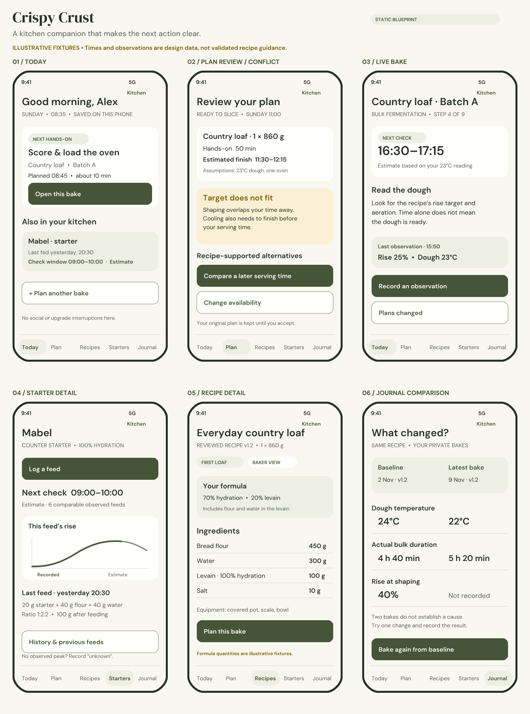
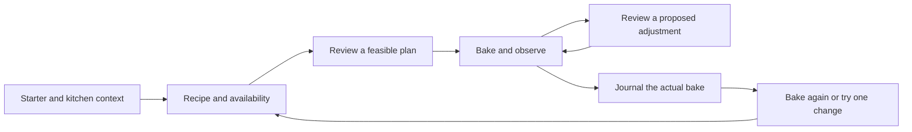

# Crispy Crust — complete mobile app build specification

**Document date:** 11 November 2026 · **Product:** [crispycrust.app](https://www.crispycrust.app/) · **Release model:** one complete public launch on iOS and Android · **Client:** Flutter.

**Read this first:** This is a proposed implementation contract built from the supplied product vision, the existing marketing repository, primary technical documentation, competitor reviews, and three independent role reviews. It is not evidence that the app, recipes, predictions or integrations already work. “Included at launch” means implemented, connected, tested and supportable before the single public release. Internal task dependencies and private testing are necessary; they are not staged product releases.

## How to use this handoff

Give the next implementation agent **this file and the entire `brand-assets/` folder**, or the complete ZIP. The main file is intentionally comprehensive. Start with decisions and the feature contract, then use the engineering contracts, UX routes, design tokens and release gates as one specification.

- [1. Decisions and evidence](#1-decisions-evidence-and-authority)
- [2. Product promise and critical assessment](#2-product-promise-and-critical-assessment)
- [3. Website boundary and commercial behaviour](#3-product-boundaries-and-commercial-behaviour)
- [4. Complete feature contract: F01–F36](#4-complete-single-launch-coverage-contract)
- [5. Recipe, learning and media commission](#5-baking-content-is-a-production-dependency)
- [6. Engineering specification](#6-engineering-specification)
- [7. Everyday-use and UX specification](#7-everyday-use-and-ux-specification)
- [8. Market research and visual identity](#8-market-research-and-visual-identity)
- [9. Build ownership, access and dependencies](#9-build-ownership-access-and-dependencies)
- [10. Release evidence and operations](#10-release-evidence-and-operational-readiness)
- [11. Implementation-agent instructions](#11-instructions-for-the-implementation-agent)

**Visual references:** [six-screen blueprint](brand-assets/screen-blueprints.png), [vector logo](brand-assets/wordmark-horizontal.svg), [app icon](brand-assets/app-icon-master.png), [design tokens](brand-assets/design-tokens.json), [asset sources and licences](brand-assets/README.md).




## 1. Decisions, evidence and authority

### 1.1 Confirmed requirements

- The product is **Crispy Crust**, a home sourdough baking companion. The original brief is `sourdough_app_product_plan.docx`, supplied in this workspace.
- The existing Next.js repository is `hristianmarkov/crispy-crust`. It is a marketing website, not the app implementation. Its four illustrative phone screens are design previews.
- The consumer product is a Flutter app for **both iOS and Android**. No functional web app, browser recipe editor, web planner or web journal is in scope.
- The user has explicitly requested **one full launch**, with all of the agreed functionality built together. There is no MVP/public beta/later-feature roadmap in this specification.
- Starter care, planning, live baking, recipes, learning, journaling, coaching, sharing, community, household collaboration, production tools and privacy controls all appear in the original brief and are included in the coverage contract below.
- The website is to remain purely marketing. Do not silently retain its current waitlist form/API as product functionality. See the website boundary in §3.

### 1.2 Evidence inspected

The three requested roles were run separately: **Engineer**, **Brand and market research**, and **Everyday user advocate**. Their findings are integrated in the technical, design/research and UX specifications in this file. Original source material also includes the website README, landing page, FAQs, stylesheet, preview components and local product-vision document. No production app database or customer records were inspected, and no website/backend changes were made for this planning task.

**Important missing information:** the supplied vision does not specify launch countries, commercial prices, an approved budget, a launch date, a legal entity, a supported probe model or the app backend project. These are owner decisions, not facts to invent from the website's writing style. English copy and metric-first input are proposed defaults; locale and launch-market selection remain explicit decisions.

### 1.3 How to interpret this file

| Label | Meaning |
|---|---|
| Confirmed | Directly requested or present in the supplied brief/repository |
| Specification / proposed decision | The recommended implementation to build unless the owner changes it |
| Validation gate | Evidence required before a claim or feature can ship |
| Open owner decision | Information or commercial/legal authority the implementation agent cannot manufacture |
| Optional | A user may opt out; it does **not** mean defer development |

The release contract and resolution rules in this front section take precedence over exploratory alternatives in the specialist sections. The technical specification governs data/engine behaviour, the design specification governs visual tokens/assets, and the UX specification governs user interaction. If two requirements still disagree, write an architecture decision with the conflict and resolve it before implementing the affected flow. Do not quietly ship a placeholder, drop a requirement, or let an AI answer determine a recipe constraint.

### 1.4 Resolved integration decisions

- **Navigation:** five tabs — Today, Plan, Recipes, Starters, Journal — with a labelled Kitchen menu for Learn, Community, Pantry, Production, Devices and Settings. The six-screen board uses this same navigation.
- **Data modes:** strict local-only means no account or baking-data upload. A user can separately create an account while keeping library sync disabled; cloud coach/import then use an authenticated, explicitly consented request containing only selected context. Account creation alone never turns on backup. Full sync is a separate opt-in.
- **Operational tools:** a separate private Flutter desktop operations build uses the same schema/API contracts and staff MFA. It is not a public product website or a hidden consumer-admin tab. Consumer app binaries must not carry privileged service credentials.
- **Starter estimates:** the proposed minimum is five comparable confirmed peak records before personalisation. Example UI uses six. This is an engineering/product threshold to validate, not proof of scientific accuracy; below threshold use reviewed broad guidance. A published statistical interval needs independent calibration evidence.
- **Commercial terminology:** this document uses **Pro** for the proposed service tier. Prices and store products are unapproved. All deterministic local tools are free in the proposal; cloud/service access has account, entitlement and quota checks.
- **Numbers in mockups:** time windows, sample records and reviewed-version labels on the screen board are illustrative fixtures. Domain/content test evidence, not artwork, determines production values.
- **Scope:** the 24-recipe commission, all F01–F36 capabilities, native companion surfaces and restricted operations tools belong to the same launch. Unsupported device models have a truthful compatibility/manual fallback, not a nonworking promise.

## 2. Product promise and critical assessment

**Promise:** “Good bread. On your time.” Help a baker maintain a starter, find a workable schedule, carry out the bake, recover when reality changes, and repeat a loaf with the same recorded conditions.

The essential loop is:



### 2.1 What makes this worth using

Recipe libraries, timers, calculators, starter trackers and journals already exist. Competing on the size of a feature list is weak. The defensible execution is the connection between **recipe-specific constraints, the baker's real availability, reliable records, and understandable recovery**. The app should be useful on a flour-covered phone in a poor-signal kitchen, not only in onboarding screenshots.

The product must answer five questions quickly:

1. What needs my attention now, and which jar/dough does it belong to?
2. What can wait, and what am I being asked to observe rather than do?
3. Can this bake fit around my actual day, equipment and cooling time?
4. If it cannot, what are the honest alternatives and their consequences?
5. What did I really do last time, and how do I repeat it?

### 2.2 Claims to reject

| Tempting promise | Required behaviour instead |
|---|---|
| “Your dough is ready in exactly 3 hours” | Show a timing window and separate readiness observations; confidence is bounded by comparable evidence |
| “The fridge pauses fermentation” | Model a tested cold-rest path, transition/cooling lag and limits; reject unsupported recovery paths |
| “AI can tell whether a starter is safe” | Route concerning observations to reviewed safety guidance; never certify safety from a photo |
| “Import any recipe and plan it perfectly” | Import to an editable draft; require ingredient, stage, timing and constraint confirmation before scheduling |
| “Works with all probes/watches” | Publish a tested compatibility matrix; native companion code and physical devices are required |
| “Timers always ring” | Store durable deadlines, use platform notifications, show permission/delivery limitations and reconcile on resume |
| “Cloud sync comes with the database” | Build and verify an explicit outbox, cursor, conflict, revocation, attachment and deletion protocol |
| “Local-only means encrypted cloud sync” | Local-only sends no baking data; opted-in sync uses transport/server encryption and is **not** end-to-end encryption |
| “Personal correlations prove what caused a better loaf” | Compare like conditions, expose sample counts/missing values, and describe associations |
| “A coding agent can validate sourdough formulas by generating them” | Human recipe authors and repeat kitchen trials establish publishable ranges and approved interventions |

### 2.3 The honest scope assessment

This is a large consumer application with a deterministic scheduling product, a content operation, a collaboration system, AI services and native integrations. The one-launch instruction is workable as a release policy. It does not eliminate dependency ordering, private device testing, recipe trials, store review, security work or operational ownership.

The riskiest technical work is the scheduling/replanning engine and offline collaboration. The riskiest product work is making a broad feature set feel simple. The riskiest scientific claim is personalised fermentation precision. The riskiest ongoing operating commitment is community moderation. Coding speed alone does not resolve any of these.

## 3. Product boundaries and commercial behaviour

### 3.1 Website and support boundary

- Keep `www.crispycrust.app` as static marketing, editorial articles, FAQs, legal information, store links and support/deletion instructions. No account dashboard, planner, recipe execution, browser checkout or web fallback for core app features.
- Replace prelaunch waitlist CTAs with accurate store/release messaging when available. Remove the waitlist route, function dependency and related claims through a separately reviewed website change; handle retained marketing-consent records under their existing notice. Do not migrate waitlist emails into app accounts or claim they consented to app analytics.
- App product data must not rely on the Next.js website, its API routes, deployment availability or waitlist database. Use separate app projects/configuration.
- App/Universal Links use static association files hosted on an app-link support subdomain. Public recipe/share links open the installed app; an uninstalled user sees a static install/instructions landing. No interactive web recipe reader is promised. Recipient redemption, revocation and private access checks occur in the app/backend.
- Google Play requires an external deletion-request route even when deletion is also in app. A static, prominent Crispy Crust deletion-instructions page can point to a monitored customer-service email; Google's documentation explicitly allows this. This preserves a marketing/information-only website while providing a usable support pathway. The owner must set up and staff the mailbox. Do not publish a made-up email address. [Google account deletion requirements](https://support.google.com/googleplay/android-developer/answer/13327111?hl=en).
- Internal moderation, content and support tools are private operational interfaces, not public website functionality. Specify them separately from the consumer app. No direct production-table editing as the normal editorial workflow.

### 3.2 Proposed business model — not approved prices

Implement entitlement infrastructure with the rest of the app. All features are built for the same release; access tiers are commercial packaging, not development stages. Recommended packaging is a useful free local companion and a paid cloud/service tier, with no advertising or sale of journal data.

| Capability | Proposed free/local access | Proposed paid service access |
|---|---|---|
| Starter care, formula maths, curated recipes, first-loaf help | Yes | Yes |
| Home/production bakes, standard and multi-bake planner, local journal and exports | Yes | Yes |
| Multiple simultaneous bakes and production planning | Yes, using local data | Yes, plus opted-in cloud collaboration |
| Cloud backup/sync and household collaboration | Account and paid service access required under this proposal | Yes |
| AI coaching, image analysis and import processing | Clearly stated trial/quota if offered | Explicit monthly quota with cost caps |
| Public discovery, reporting, safety guidance, data export/deletion | Never paywall safety or privacy controls | Same |

All deterministic local baking tools, including multi-bake and production planning, remain usable in the proposed free local tier. Paid access pays for the ongoing cloud/service operation. These proposed boundaries must be finalised before wiring paywalls. Do not infer a price or trial length. Storefront-localised prices, subscription terms, renewal cadence and territories are owner decisions. The engineering section defines purchase/restore/reconciliation behaviour. Never interrupt a live step, observation, ongoing timer or an already-started bake with a paywall. Entitlement loss cannot remove a user's existing records or their ability to view/export them. Do not market unlimited AI unless its cost model supports it.

Use Apple/Google native in-app purchasing for the normal digital-subscription path, with server-verified entitlement state; assess current storefront rules before submission. The website is not a subscription workaround. No seller payouts, paid creator marketplace, customer bread ordering, tax/accounting system or merchant-of-record feature is implied by “production view.”

## 4. Complete single-launch coverage contract

Every row is part of the same release. The UX destination names are defined in the UX specification later in this file. A feature is complete only when its data, UI, domain behaviour, permissions, errors, offline behaviour and acceptance evidence exist.

| ID | Included capability | Main surfaces | What must be true to call it complete |
|---|---|---|---|
| F01 | Today, pinned cards, First Loaf/Baker mode, join an existing bake | Today; onboarding; live bake | Contextual next action, date/window, jar/dough label; switch help level mid-bake without changing data |
| F02 | New, established, gifted and multiple starters; lineage | Starters; starter editor; care card | Track parent/offshoot, flour/hydration/storage and unknown age accurately; no compulsory restart |
| F03 | Feed repeat, calculator, retained/build/discard weights; correction/backdating | Feed sheet; history | Inputs conserve mass; distinguish planned versus actual; correction preserves audit history |
| F04 | Counter, fridge, travel, pause, snooze, revival and low-waste maintenance | Starter care plan | Per-jar schedules, no guilt streaks; recipe starter needs and retained amount reconciled |
| F05 | Rise/temperature observations, guided photo sequence, charts, time-lapse | Starter observation; monitoring | Mark missed peaks unknown; manual confirmation before photo-derived measurements affect engines |
| F06 | Personalised starter check/peak windows and troubleshooting | Starter detail; contextual help | Show comparable sample count, conditions, broad fallback and reviewed spoilage guidance |
| F07 | Forward, backward and in-progress planning; cooling included | Plan wizard; timeline | Start/mix/oven/serve anchors distinct; all windows and hands-on obligations visible before acceptance |
| F08 | Availability, sleep, saved templates; optional calendar busy import/export | Availability editor; calendars | No hidden overnight obligations; request minimum permissions; no event-title collection for busy import |
| F09 | Kitchen temperatures, oven, vessels, loaf/pan dimensions, fridge capacity | Kitchen setup; plan review | All assumptions displayed; missing kitchen data is explicit; one Dutch oven can never do two simultaneous loads |
| F10 | Multiple bakes, resource conflicts, compatible task batching | Combined timeline; production | Separate dough events; oven transitions/reheat, cooling and capacity represented; conflict explanations usable |
| F11 | Scale by count/weight/percentages; units; shopping/prep/print sheets | Formula editor; recipe; lists | Starter flour/water counted once; uncertain volume conversions marked; rounding never changes stored formula |
| F12 | Delay/missed fold/slow rise/oven failure recovery | “Plans changed” sheet; comparison | Freeze actual history; show recipe-supported alternatives, new serve window and reminder changes before apply |
| F13 | Kitchen-friendly live steps, current ingredient weights, screen awake, voice | Live bake; voice sheet | Large controls; optional per-session awake state; speech transcript confirmed before mutations |
| F14 | Independent durable timers, snooze/backdate/early completion, missed alerts | Live bake; timer centre | App kill/restart/reboot and permission denial tested; current state reconstructed from timestamps/events |
| F15 | Lock-screen activity, widget and supported watch status/action | Native surfaces; app deep links | Swift/Kotlin platform targets, explicit OS/device support, stale-state labels and constrained quick actions |
| F16 | Dough readings, percentage rise, side-by-side photos, no-thermometer route | Observation sheet; comparison | Separate estimated check from observed readiness; no fake precision when data is missing |
| F17 | Supported probes and foreground camera monitoring | Device manager; capture session | Published device/protocol tests; disconnect/staleness/battery/foreground status; manual entry always available |
| F18 | Short technique demonstrations, captions/text/left-handed views and private step notes | Step help; Learn | Reviewed, rights-cleared assets; pinned offline lesson packs; notes carry into a copied bake |
| F19 | Bread-family recipe collection and precise filters | Recipes; filters; detail | Distinct execution graphs for rye/focaccia/pizza/enriched/discard; no one-loaf method stretched to every bread |
| F20 | URL/photo/text recipe import, source attribution, private copies and versions | Import review; editor | SSRF/content limits; human review; imported constraints never labelled tested automatically |
| F21 | Courses, practical exercises and contextual learning | Learn; first-loaf path | Resume points and exercise evidence; help always returns to current bake without losing its state |
| F22 | Flour/equipment substitution, custom ingredients, uncertainty | Formula editor; swap review | Explain changed hydration/handling/equipment constraints; outside validated envelope marked experimental |
| F23 | Pantry, flour notes, discard inventory, aggregated shopping, batch cost | Pantry; shopping; recipe | Units/stock events consistent; user prices dated; no invented live grocery prices |
| F24 | Accessibility, units, printable/shareable formula and schedule | Every screen; export | Dynamic text, screen readers, captions, contrast, reduced motion, large targets and simple view verified |
| F25 | Automatic journal, outcomes, notes/photos/tags; Bake Again | Journal; bake summary | Exact immutable formula version, timeline and corrections retained; copies get new IDs |
| F26 | Side-by-side comparisons, charts, baselines and one-variable experiments | Journal compare; experiment | Show missing variables/sample counts; do not turn personal associations into causal advice |
| F27 | Contextual text coach, optional image/crumb analysis, reviewed sources | Coach; analysis review | Per-request consent/context preview; suggestions cannot directly mutate a plan; uncertainty and report action |
| F28 | Personal recipe book, structured data export, selected bake-card share | Journal; export; share preview | Export works without a subscription; private photos/metadata excluded unless selected |
| F29 | Runnable attributed recipe links, starter care links, revisions, revocation | Share sheet; recipient preview | Copy vs live link behaviour explicit; revoked link fails online; already-saved recipient copies cannot be recalled |
| F30 | Households/shared bakes, view/edit roles, tasks and acknowledged handoffs | Household; assignments; activity | Explicit membership, revocation and stale offline edits; actor attribution; no last-write-wins loss of feeding/completion |
| F31 | Community bakes/groups/challenges, publish loaf, creator saves/updates | Community; bake-along; creator | Private by default; report/block, moderation/appeal and notification preferences; no public exposure of kitchen availability |
| F32 | Production view, quantities/pickup windows/oven loads/labels/pack lists/cost/yield | Production workspace | Separate home/production context; batch traceability and resource checks; no commercial food-safety certification claims |
| F33 | Reminder preferences, quiet hours, pins, social/coach controls | Settings; Today | Separate safety-critical/user timers and routine reminders; no silent override of permission/quiet-hour choices |
| F34 | Local-only use, opted-in cloud sync, multi-device backups | Privacy; sync; account | No network account required for core local use; explicit migration/restore/conflict UX; no promise of end-to-end encryption |
| F35 | Granular photo/calendar/device/sharing consent; record/account deletion | Privacy; permissions; account | Permissions requested at point of use; export/revoke/delete tested across objects, shares, providers and sync devices |
| F36 | Complete operational product | Private content/moderation/support tools | Editorial publication, migrations, review queues, support ownership, backups/restore, quotas and incident runbooks ready |

### 4.1 Deliberate non-features

The brief does not require selling bread, supplier ordering, medical/dietetic advice, public direct messages, location tracking, contact-book access, ads, generic social-media engagement loops, a third-party developer platform, a web app or guaranteed automatic diagnosis. Do not add these while implementing. Public sharing and production planning already create substantial scope.

## 5. Baking content is a production dependency

### 5.1 Proposed launch catalogue: 24 original, tested recipes

The following is a concrete **content commission**, not a claim that recipes exist or are validated. Each record must be authored/licensed and tested before release. Renaming an internet recipe does not clear its text/photos or turn its timing into app-owned guidance.

| Recipe IDs | Recipe | Distinct method requirements |
|---|---|---|
| R01 | First white sourdough | Beginner cues, moderate hydration, fully guided process |
| R02 | Everyday country loaf | Standard baseline and repeat-bake comparison |
| R03 | High-hydration country loaf | Different handling and readiness cues |
| R04 | Half-wholemeal loaf | Flour blend and tested fermentation range |
| R05 | Wholemeal tin loaf | Pan loading, proof height and baking profile |
| R06 | Seeded mixed-flour loaf | Soaker/liquid accounting, allergen flags |
| R07 | Light rye mixed loaf | Rye-specific handling guidance |
| R08 | High-rye tin loaf | Distinct mixing/proofing, no wheat-fold assumption |
| R09 | Full rye tin loaf | Dedicated rye method and cooling/slicing guidance |
| R10 | Wholewheat batard | Shape/equipment-specific technique |
| R11 | White sandwich tin loaf | Pan size, yield and proof-height limits |
| R12 | Enriched milk loaf | Dough composition and safe handling guidance |
| R13 | Brioche-style sourdough | Egg/butter addition stages and temperature limits |
| R14 | Plain focaccia | Tray capacity, pan proof, oil accounting |
| R15 | Olive and herb focaccia | Inclusions, toppings and tray-specific bake |
| R16 | Room-proofed pizza dough | Balling, proof, equipment-specific baking options |
| R17 | Cold-proofed pizza dough | Supported cold path and warm-up window |
| R18 | Sourdough bagels | Division, shaping, boiling and baking resources |
| R19 | Dinner rolls | Piece weights and tray capacity |
| R20 | Discard crackers | Required discard hydration, no fermentation promise |
| R21 | Discard pancakes | Discard+leavening composition and portion scaling |
| R22 | Discard waffles | Waffle equipment and batter method |
| R23 | Discard flatbreads | Pan batches and rolling/cooking tasks |
| R24 | Cinnamon rolls | Enrichment, filling, tin proof and finish |

Dietary filters are evidence-based ingredient filters. The catalogue does not yet promise gluten-free/coeliac-safe recipes. Do not let a missing allergen field mean allergen-free; do not describe wheat sourdough as gluten-free. All substitutions must recompute ingredient flags and identify uncertain handling. Shared-kitchen cross-contact cannot be inferred from a recipe.

### 5.2 Required recipe/content manifest

Every published recipe/version must include identity, source and rights, author/reviewer, exact mass formula, preferments, flour blend, hydration definition, yield/pan dimensions, equipment/capacities, stage graph, condition-dependent duration ranges, readiness cues, approved optional branches, cooling and slicing guidance, allergens, substitution envelope, image/video rights, offline assets, revision notes, engine compatibility and a test record.

For each supported route record which kitchen trials justify it: ambient/dough/fridge temperatures, flour identifiers, starter maturity and feed, equipment/load, measured timeline, final outcome, photos and reviewer. Repeat baseline bakes, cool/warm conditions and claimed adaptations. “At least four reference trials per recipe” is a planning allowance, **not** proof that four trials validate every range. A separate tested cold-rest branch or flour swap needs its own evidence. Do not hard-code a popular internet rise chart as a universal engine or republish it without permission.

The app may launch broad **check windows** with no personalised precision claim. It must not label a percentage as a statistical confidence interval unless the model was evaluated and calibrated for that claim. Starter and dough histories are different populations and must not be pooled casually.

### 5.3 Learning and media delivery

Commission a complete first-starter/first-loaf course and technique packs for every method used in the catalogue: feed and measure a starter; weigh and mix; temperature/rise observation; stretch/coil folds; preshape/bench rest; boule/batard/tin shaping; rye handling; focaccia; pizza balling; bagel shaping/boiling; enriched dough; scoring/oven loading; cooling; reading a crumb and recording an experiment. Each item needs concise text, captions/transcript, a short demonstration, stills/alt descriptions and left-handed views where meaningful.

Use actual documented bakes for instructional and diagnostic examples. Generated bread images are acceptable as clearly identified marketing concepts; they are not measured outcomes, evidence that a formula works, or a labelled training/evaluation set. The supplied brand concept has an illustrative recipe/time label; it establishes no validated five-hour recipe.

Publish content through draft → review → tested → published → retired states in the private content tool. Published versions are immutable. Retiring a recipe hides it from new discovery but never silently rewrites active or historical bakes. A separate urgent guidance correction can surface on old versions, with an explanation and safe resolution.

### 5.4 Food guidance boundaries

Spoilage concerns use human-reviewed guidance with source/review date; image analysis cannot certify safety. For example, King Arthur's starter guide identifies visible mould or pink/orange changes as reasons to discard a culture. Treat these as reviewed help content, not a probabilistic visual “safe” badge. [King Arthur starter guide](https://www.kingarthurbaking.com/learn/guides/sourdough/create).

Temperature and rise are relevant observations, but method, flour, inoculation and cooling behaviour matter. External specialist guidance supports using observations alongside time; its exact charts are not universal specifications. [Bulk fermentation timing, The Sourdough Journey](https://thesourdoughjourney.com/faq-bulk-fermentation-timing/).


## 6. Engineering specification

Prepared 11 November 2026. This is a proposed implementation contract, not evidence that an app already exists. It covers one complete public launch on iOS and Android. Dependency ordering, internal integration builds and private release-candidate testing are engineering requirements within that single launch, not reduced public releases.

### 6.1 Evidence and decisions

Confirmed from the workspace:

- The supplied `sourdough_app_product_plan.docx` describes all six product areas: starters, planning, live bake, recipes/learning, journal/coaching, sharing/advanced tools. The scope is substantially larger than a recipe-and-timer app.
- `/workspace/crispy-crust` is a Next.js marketing site with illustrative app previews. There is no Flutter application in this checkout. Its `README.md` documents a Supabase-backed waitlist, not a mobile-app backend. Existing Supabase schema names still use `crumb_clock`; do not infer this is a finished product identity or reuse those tables as the app database.
- This runtime is Linux. Java is present. `flutter`, `dart`, `supabase` and `xcodebuild` were not found on PATH during inspection. This does not establish whether they exist on the user's other machines. iOS builds require a macOS/Xcode builder.
- Website product tools must stay out of scope. Remove functional planning/recipe previews and the existing waitlist submission/removal flows when implementing the user's new website constraint, unless the user separately chooses to retain lead capture. Static examples, articles, screenshots, pricing copy and app-store links remain marketing.

Recommended architecture:

1. Flutter, Dart, Riverpod for state/dependency injection, GoRouter for navigation, Drift/SQLite for durable local data. Pin compatible stable versions at bootstrap; commit lockfiles and document SDK/tool versions.
2. A pure-Dart `baking_domain` package owns formula math, execution graphs, schedule solving, starter estimates, state reduction, comparisons and export serialization. No widget, network, LLM or Supabase dependency in this package.
3. Supabase Postgres, Auth, Storage and Realtime provide opt-in cloud sync, accounts, shared kitchens and community. Separate development, test and production projects. The app must not share a production database or service secrets with the marketing waitlist.
4. Short TypeScript/Deno Edge Functions handle authenticated sync commands, server-side AI-provider requests, controlled URL import, share redemption, invitations, purchase verification/webhooks, deletion and moderation commands. Durable Postgres jobs/queue drive retries. Long or CPU-heavy rendering belongs on the client; media inference uses a contracted provider endpoint, not an unbounded Edge worker.
5. Swift/SwiftUI extensions implement iOS Live Activities/widgets/Apple Watch. Kotlin/Jetpack components implement Android widgets and Wear OS companion. Flutter does not erase these native workstreams.
6. AI produces reviewed suggestions and structured drafts. Deterministic engines alone calculate amounts, authorize transitions and commit plans. Loss of the AI service cannot stop an active bake.

The Supabase client is not an offline-sync engine. Realtime is an invalidation signal, not a durable event log or synchronization guarantee. The explicit sync protocol below is part of the build. Flutter's official offline-first guide supports repository mediation between local and remote sources; the particular event and conflict design here is our proposal. [Flutter offline-first guidance](https://docs.flutter.dev/app-architecture/design-patterns/offline-first).

#### Version warning for the next agent

The current Supabase changelog reports CLI v3 changes and a Flutter v3 transition around the date of this plan. Read the release notes and resolve an actually available stable compatible SDK before writing setup commands. Do not assume an announced release has already reached the package registry. Pin the validated CLI and SDK; generate types where supported; do not use unstable typed APIs merely because they are new. Discover every CLI group through `--help`. Explicitly select the target environment in CI. These are material changes, not a reason to copy older `anonKey`, package imports, sort defaults or remote-deployment flags without verification. [Flutter v3 release notes](https://supabase.com/changelog/supabase-flutter-v3), [CLI v3 release notes](https://supabase.com/changelog/supabase-cli-v3).

### 6.2 System boundaries and repository structure

```text
crispy-crust-app/
  apps/mobile/                  Flutter iOS + Android
  packages/baking_domain/       formula, graph, planner, state, predictions
  packages/app_data/            Drift schema, repositories, sync, media cache
  packages/design_system/       tokens, components, semantics
  packages/content_models/      recipe/lesson JSON schema and validation
  native/watchos/               SwiftUI companion and connectivity
  native/wearos/                Wear OS companion and data layer
  supabase/migrations/          reproducible schema, policies, jobs
  supabase/functions/           privileged API adapters
  content/recipes/              source-controlled reviewed versions
  content/lessons/              reviewed guides, safety guidance, captions
  content/profiles/             fermentation and equipment profiles
  tools/content_validator/      publication checks, fixtures
  test/fixtures/                exact cross-platform expected outputs
  integration_test/             real service + real device flows
  docs/runbooks/                restore, deletion, incidents, signing
```

Marketing remains in its own deployment/repository boundary. App needs can use a dedicated `links`/`support` origin for association files, static store fallback and required support/deletion instructions. These are distribution and support infrastructure, not a web baking app. Uninstalled recipients see an app download destination; they cannot run the shared recipe on the website. Configure Apple universal links and Android verified app links; no reliance on deprecated third-party dynamic-link products. Once installed, a user can reopen the original share link or enter a share code. Do not promise guaranteed deferred deep linking after install.

### 6.3 What must exist before a release build can be distributed

| Dependency | Access needed | Owner / evidence to collect |
|---|---|---|
| Product ownership | Final name, legal entity, target countries, age policy, privacy controller, support address | Founder; record decisions in `docs/decisions.md` |
| Source repository | Private GitHub repository, branch protection, CI access | Organization-controlled; no personal-only ownership |
| Apple | Developer Program team, App Store Connect roles, bundle IDs, signing/provisioning, APNs key, app groups, associated domains, Sign in with Apple config | Account Holder accepts contracts; scoped App Store Connect API key in CI vault |
| Google | Play Console organization, identity verification, package ID, Play App Signing, upload key, service account, test tracks and test devices | Owner-controlled recovery; verify current testing requirements for exact account type |
| Build machines | macOS/Xcode stable builder; Android SDK/JDK builder; Android and iPhone physical devices | Pin compatible toolchain and signing runbook |
| Supabase | New app dev/test/prod projects, billing approval, region, scoped deployment credential, migrations, backup/PITR choice | Read/write dev; production deployments through protected CI |
| Email | Production SMTP/API sender, verified domain, SPF/DKIM/DMARC, abuse/rate caps | Needed for email OTP; default sandbox sender is not a production plan |
| AI | Contracted multimodal/OCR/text endpoint, retention/DPA/data-region decisions, project key and cost limit | Server vault only; no personal ChatGPT session used as application backend |
| Payments, if paid | Store product IDs, agreements, tax/banking, sandbox accounts, receipt verification credentials | Final commercial model must be chosen before build completion |
| Content | Baking expert, recipe testing kitchen, original/licensed media and attribution ledger | Scientific and editorial sign-off are explicit deliverables |
| Bluetooth | Named compatible device models, protocol documentation and real hardware | Standard BLE capability alone does not mean commercial-probe compatibility |
| Community | Named moderation owner, report queue staffing, rules, escalation/takedown procedure | A public feed without operational ownership is not launchable |
| Support/observability | Crash/metrics destination, privacy choices, alert recipients, service access | Log redaction and incident responsibility |
| Domain | DNS control for app links, auth redirects, sender authentication, support URLs | Founder-controlled domain recovery |

No secrets in Markdown, chat, screenshots, public `.env` files or mobile assets. Mobile may contain the Supabase public/publishable project key; that grants no entitlement and must be paired with RLS. Service role, AI, SMTP, APNs private material and store verification credentials stay server-side or in the build vault.

#### MCPs and tools

MCPs are development aids, not app runtime dependencies. Flutter/Dart CLI, Xcode, Gradle, native debuggers and hardware remain essential even if an MCP is connected.

- Already discoverable in this session: GitHub and Supabase tools, web research and image generation. Verify actual project/account permissions before using any write operation. Infrastructure discovery and connection status are recorded in §9.1. No new paid service or plugin is provisioned by this plan.
- Useful optional additions: Figma connector for reviewed screen/token handoff; crash-reporting/analytics connector once those services are chosen; App Store Connect/Play APIs through scoped CI tools. None is a prerequisite for writing the app. Prefer official APIs/CLI over installing an unverified community MCP with broad access.
- Supabase MCP should be scoped to the development project; use read-only production access for diagnosis. Database changes are reviewed migrations, not freehand production MCP writes.
- This environment needs Flutter/Dart and Android dependencies installed; a macOS builder must be attached separately. Record network domains and credentials in environment settings. App build completion cannot be claimed from the current website's Playwright tests.

### 6.4 Account and data modes

#### Local-only

Local-only is a real unauthenticated mode, not a hidden anonymous cloud account. Starter care, bundled/downloaded recipes, custom formulas, deterministic planning, timers, journal, comparisons, pantry, production planning and local exports work without registering. No automatic journal/photo/telemetry upload. State is durable in SQLite with media in an app-owned directory. Use OS file protection and secure storage for keys/tokens; use a verified SQLCipher-compatible database configuration for an additional app-data encryption key if that is the release security choice. Verify backup exclusions and key restoration behavior together; an encrypted backup with a missing key is a data-loss bug.

Cloud AI, URL fetch, invitations, public posting and cross-device sync need a network and an app account for quota/abuse controls. Local-only can import pasted text/manual formulas and on-device OCR. A local-only user requesting the cloud coach first sees account/service requirements, then may create an account while keeping library backup/sync disabled; each request previews and uploads only the selected context with explicit consent. This is an account-with-local-library mode, distinct from strict local-only/no-upload mode. Creating an account never itself enables library/photo backup. Do not quietly upload a whole library after an AI question.

Local-only is not a backup guarantee. Explain that uninstall/device loss can lose data unless the user exports an archive or enables cloud backup. Offer archive export before destructive local reset. No local recovery promise after losing an encryption password.

#### Account mode

Offer Continue locally, Sign in with Apple, Google, and email OTP. Request sign-in when the user asks for backup/collaboration, not before the first feed. Use Supabase-supported mobile flows, PKCE/state validation and explicit redirect allowlists. OTP copy never reveals whether an email exists; resend throttles, paste/autofill support, expired-code and deliverability states are required. Production sender/domain setup is a launch dependency. [Supabase passwordless email documentation](https://supabase.com/docs/guides/auth/auth-email-passwordless).

Store refresh material in platform secure storage; audit the actual SDK storage defaults instead of assuming its persisted session is encrypted. Reauthentication for account deletion, email change, provider linking and ownership transfer. Identity linking requires an authenticated proof of both accounts; never merge identities by matching email text alone. Test Apple private-relay email and cross-platform restore. A cloud token expiring offline must not block the local active bake. Cloud requests reauthenticate when connectivity returns.

When local data becomes cloud-backed, show a preview with counts/storage impact and choose merge or keep the account library separate. Assign stable UUIDs before upload, preserve lineage and upload idempotently. Signing out offers keep a private local copy or remove account data from this device; revoke tokens, cancel other-account notifications, clear media URLs and keys, and switch to a distinct local namespace. Shared-kitchen cached access is removed on sign-out. One user's cache must never appear in another user's session.

Cloud transport encryption and managed storage encryption do not constitute end-to-end encryption. Server AI, moderation, server search and multi-user sync can read authorized cloud data. Do not market cloud data as E2EE unless a separate key-sharing and recovery architecture is actually implemented.

### 6.5 Canonical domain and database contracts

Use UUID entity/event IDs, UTC `timestamptz` for absolute times, IANA time-zone IDs for local intentions, canonical grams and Celsius for measurements. Keep original user units as display metadata. Money is integer minor units plus ISO currency; no cross-currency sum without an explicit rate. Formula calculations use deterministic decimal/rational arithmetic, not display-rounded floats. Durations are integer seconds. Explicit `unknown` is distinct from zero, false, not observed and not applicable.

Every syncable aggregate has `id`, `kitchen_id`, `created_by`, `schema_version`, `revision`, `created_at`, `updated_at`, optional tombstone. A personal kitchen has one owner. A household or production kitchen has explicit members. Public community is a separate publication boundary, not a policy allowing strangers to browse private kitchen rows. User-private journal items belong in the personal kitchen unless deliberately moved/copied to a household space.

| Tables / aggregates | Required content |
|---|---|
| `profiles`, `preferences`, `consent_records` | Locale, units, guidance mode, quiet hours, consent purpose/version/time; no public email |
| `kitchens`, `kitchen_memberships`, `kitchen_invites` | Personal/household/production type, owner; viewer/editor/admin roles; single-use expiring hashed invitation tokens |
| `equipment`, `resource_capacities`, `availability_rules`, `availability_exceptions`, `schedule_templates` | Oven temp ranges/preheat/changeover, vessels, fridge slots, busy/available intervals, IANA zone; calendar titles never stored |
| `starters`, `starter_lineage`, `starter_feed_events`, `starter_observations` | Flour mix, hydration, storage mode, retained mass, feed ratio, observed height/temp/peak, correction links, provenance |
| `discard_lots`, `discard_transactions` | Generation date/amount, storage context, uses, disposal; unknown age state; do not certify food safety |
| `ingredients`, `ingredient_densities`, `pantry_lots`, `pantry_transactions`, `ingredient_prices` | Flour and allergen metadata, brand notes, density source, stock adjustments/reservations, pack pricing/currency |
| `recipes`, `recipe_versions`, `recipe_ingredients`, `recipe_steps`, `recipe_branches`, `fermentation_profiles` | Immutable executable recipe version, graph, reviewed ranges, formula basis, rights/source, content status |
| `bakes`, `bake_batches`, `bake_events`, `bake_observations` | Versioned formula snapshot, recipe/profile versions, workspace, state, events and actual measurements |
| `schedule_versions`, `schedule_tasks`, `resource_reservations`, `reminder_intents` | Candidate/accepted/superseded plan, task windows, actor/resource allocations, derived notifications |
| `journal_entries`, `outcome_ratings`, `experiments`, `recipe_baselines`, `bake_tags` | Results, personal notes, changed variables, comparability/missing data, baseline linkage |
| `media_assets`, `media_attachments`, `analysis_requests`, `analysis_results` | Object key, hash, owner, bytes/dimensions, EXIF stripping, upload state, separate consent and versioned inference |
| `lessons`, `lesson_versions`, `lesson_progress`, `reviewed_guidance` | Curriculum, step deep links, captions/transcripts, safety review/expiry dates |
| `coach_threads`, `coach_messages`, `coach_context_grants` | Only selected recipe/measurements, sources, provider/model version, retention state; not full-database chat access |
| `shopping_lists`, `shopping_items`, `production_runs`, `production_loads`, `pack_labels` | Unit-consistent demands, inventory reservations, oven loads, recipient/pickup labels and yield |
| `shared_cards`, `share_tokens`, `publications`, `recipe_follows` | Selected immutable public copy, revocation/expiry, visibility, attribution and update subscriptions |
| `community_groups`, `group_members`, `bake_alongs`, `challenge_entries`, `posts`, `comments`, `reports`, `blocks`, `moderation_actions` | Opt-in audience, moderation status, rules, safety responses, block enforcement |
| `devices`, `push_tokens`, `sensor_bindings`, `sensor_readings` | Installation ID, capabilities, token rotation, hardware model/protocol, timestamps, stale/calibration states |
| `store_transactions`, `entitlements`, `webhook_receipts` | Verified immutable provider transaction IDs, product/expiry/grace/refund, idempotency; no client-writable entitlements |
| `sync_operations`, `sync_changes`, `sync_device_cursors`, `deletion_jobs`, `audit_events`, `job_runs` | Idempotency, per-kitchen sequence, membership version, retention cutoff, durable retries, security audit |

Recipe/lesson structured documents can be JSONB for the versioned graph, but searchable fields, owners, timestamps, join keys and constraints remain typed columns. Validate JSON against a versioned schema. Use foreign keys and check constraints for nonnegative masses/valid ranges. Do not allow a client to change `kitchen_id`, event actor, approved-content status, billing state or moderation role through generic table updates.

Indexes: all FK columns used in joins; `(kitchen_id, updated_at, id)` for incremental pulls; unique `(kitchen_id, device_id, operation_id)`; unique `(bake_id, aggregate_sequence)`; `(kitchen_id, due_at)` partial index for active reminders; `(starter_id, occurred_at desc)`; `(recipe_id, version)` unique; `(user_id, kitchen_id, status)` membership lookup; approved publication feed keyset cursor; PostgreSQL full-text/trigram search for content. Avoid offset pagination for growing journal/feed. Test actual `EXPLAIN (ANALYZE, BUFFERS)` plans with representative private and shared datasets.

#### Authorization and RLS

- RLS on every exposed table, plus minimal SQL grants. Tables not intended for clients live in private schemas with no Data API access. Authorization combines current database membership and resource ownership. `TO authenticated` alone is never authorization.
- Personal owner pattern: SELECT/DELETE `USING ((select auth.uid()) = owner_id)`; INSERT `WITH CHECK`; UPDATE both `USING` and `WITH CHECK`. Shared rows use indexed membership checks and required role, not client-editable metadata or stale JWT role claims.
- Keep memberships read-only from generic client tables. Invitation acceptance, role changes, ownership transfer and removal are validated atomic commands. Do not use recursive policies that requery themselves indefinitely.
- Views use invoker security where supported; privileged functions have fixed empty/search-safe paths, narrow grants, internal identity checks and explicit audit. No service-role key on the client. Storage bucket policy must validate the referenced resource and kitchen membership, not just a user-controlled filename prefix.
- Private photo buckets use short-lived signed URLs issued after authorization. A public share publishes a sanitized copy; it never turns the private original bucket public. Revoke public share access, delete its published media copy and explain that screenshots/previous downloads cannot be recalled.
- Test owner, different owner, editor, viewer, removed member, anonymous and service-role contexts through real authenticated JWTs. Include moved-row, forged-kitchen, unauthorized media replacement, stale membership, and nonexposed view/function cases.

These are concrete implementation choices informed by Supabase security guidance; the new agent must run advisors and verify policies in the actual deployed version. [Supabase RLS documentation](https://supabase.com/docs/guides/database/postgres/row-level-security).

### 6.6 Durable offline and multi-device sync

The app reads the local repository and commits all critical user actions to a SQLite transaction before reporting success. Each transaction writes the domain event, projection and outbox record. Media capture saves a local file and durable attachment record before upload. Never keep an observation only in a widget or an upload-in-flight buffer.

Event envelope:

```json
{
  "event_id": "uuid",
  "operation_id": "uuid",
  "aggregate_id": "bake-or-starter-uuid",
  "kitchen_id": "uuid",
  "type": "StepCompleted",
  "schema_version": 1,
  "base_revision": 17,
  "occurred_at": "2026-11-14T11:12:00Z",
  "recorded_at": "2026-11-14T11:15:00Z",
  "device_id": "uuid",
  "payload": {"step_id": "fold-2", "actual_duration_seconds": 120}
}
```

Server assigns trusted actor, received time and monotonic kitchen change sequence. Client clock does not authorize ordering. Preserve occurrence time for backdating but bound unreasonable values and flag clock skew. UUID/idempotency protects reconnect retries. Exactly-once HTTP delivery is not assumed.

1. Push a bounded batch of outbox operations with auth, kitchen and base revision. Server verifies membership and schema, atomically accepts or returns a structured conflict. Accepted operations return server revisions/change cursor. Retry transport errors with bounded exponential backoff/jitter.
2. Pull changes after last acknowledged per-kitchen cursor, page in transactionally ordered batches, apply local reducer, persist cursor in the same local transaction. Auth scope limits the stream. Tombstones survive longer than the supported offline-sync retention period; devices older than that need a full resync with local-change review.
3. Realtime tells connected devices to pull. App resume, successful push and user refresh also pull. Network status alone does not prove the API is reachable.
4. Attachments upload independently with checksum/content-type/size checks and idempotent object IDs. An unfinished photo upload never blocks feed or step logging. Delete locally only after accepted upload plus verified local-cache retention rule.
5. Projections are rebuildable from events. Reducer/schema versions are migrated explicitly. Export contains both snapshots and user-relevant events.

Conflict rules:

| Concurrent action | Required result |
|---|---|
| Two independent temperature/photos/notes | Union by event ID; show both; source/actor visible |
| Same step completed on two devices | One canonical transition, preserve duplicate log as reconciliation evidence; no double inventory consumption |
| Two distinct physical feeds of one jar while offline | Do not silently merge into one feed or assume both were done; ask which happened, retain correction audit; derived mass/peak estimate marked unresolved |
| Plan edit against changed bake | Reject stale `base_revision`, recompute proposal against latest state; completed actions immutable |
| Same recipe edited offline twice | Fork two immutable versions and ask which to use; never overwrite the version pinned to active bakes |
| Pantry decrement/retry | Idempotent ledger transaction; distinguish planned reservation from actual use; no double deduction |
| Deleted item updated offline | Tombstone wins cloud state; offer saving pending edit as a separate local copy, never resurrect automatically |
| Household permission revoked | Reject later writes, purge synced shared cache when informed, stop reminders for removed access; explain that an offline device or downloaded export cannot be remotely erased instantly |

Active shared bakes have one plan-controller at a time, represented by a renewable lease and aggregate revision. Other editors can record assigned tasks/observations. A lease is a usability aid, not a substitute for server CAS. Offline plan changes are provisional and clearly labeled; another member must not receive a falsely authoritative updated plan until committed. Handoffs require acknowledgement, actor labels and an audit trail. Invitees never become admins automatically.

### 6.7 Recipe execution and formula engine

Every recipe is both editorial content and a machine-readable execution graph. A paragraph-only import cannot become a reliable adaptive schedule automatically.

Required recipe-version fields:

- Immutable ID/version, title, source/rights, author attribution, skill, equipment, ingredient/allergen tags, tested yields and stage-specific food-handling guidance.
- Formula basis: total flour definition, exact ingredient quantities, starter hydration, prefermented flour fraction, flour blends, inclusion water definitions, units/densities, dough yield and bake-loss estimate with uncertainty.
- DAG of steps: stable step ID/type, dependencies, min/nominal/max duration, hands-on subintervals, allowable start/finish window, participants, equipment capacity, oven temp profile, fridge slot use, readiness cues, observation schema, technique lesson links and skip/correction rules.
- Tested alternate branches: e.g. room final proof or cold final proof; stage-specific validity preconditions, allowed duration/temp ranges, extra checks and consequences. Not a generic “pause any dough” flag.
- Fermentation profile provenance: recipe/flour/inoculation/temperature domain, parameter version, validation samples, uncertainty, expiry/review status. An imported recipe is `unvalidated` until its graph/ranges are confirmed. Scaling outside a tested yield warns that pan geometry, heating and fermentation may change.

Formula equations with fractions, not percentages in computation:

```text
total_flour = F
total_hydration = h
salt_fraction = s
prefermented_flour_fraction = p
starter_hydration = hs
starter_flour = p * F
starter_water = hs * starter_flour
starter_mass = starter_flour + starter_water
final_added_flour = F - starter_flour
final_added_water = h * F - starter_water - other_counted_water
salt = s * F
total_dough_mass = sum(all physical ingredient masses exactly once)
```

Do not double-count levain flour/water. An inclusion such as milk/egg has separate total ingredient mass and a documented water-content assumption; show a conventional baker's hydration plus any separately labeled effective-water estimate. “20% starter by total flour” differs from “20% prefermented flour”; the import review must ask which interpretation applies. Reject negative final-added water/flour and physically impossible ratios instead of silently correcting them.

Exact fixture F=1000 g, h=.75, s=.02, p=.10, hs=1: starter 200 g, final-added flour 900 g, added water 650 g, salt 20 g, total physical dough 1770 g. Two equal dough portions are 885 g before baking. A 50%-hydration starter at the same p supplies 150 g starter and requires 700 g added water; total dough stays 1770 g. A formula with h=.40, p=.50 and hs=1 needs negative added water and is invalid.

Scale all ingredients through the exact basis, keep unrounded values for storage, and round only a weigh-out presentation with an explicit 1 g/0.1 g precision setting. Ensure displayed physical ingredients sum to displayed batch target using a documented residual adjustment to flour/water, and display the resulting rounded hydration when material. Do not round starter subcomponents independently and then add them again. Mass/volume conversion needs an ingredient-specific density, source and uncertainty; no universal cups-to-grams conversion for flour. Prefer grams for reliable baking. Celsius/Fahrenheit conversion is exact before display rounding.

Starter feed fixture: 20 g seed at 100% hydration +40 g flour +40 g water is a 100 g 1:2:2 build at 100% hydration. Building 200 g levain plus 20 g retained mother at that ratio from a single combined build requires 44 g seed +88 g flour +88 g water =220 g, then split; do not accidentally demand only 200 g and strand the mother. If separate maintenance/levain jars are chosen, the calculation must show the separate builds and available seed. Backdated feed/correction recalculates later derived inventory only after user review if subsequent physical use conflicts.

### 6.8 Fermentation and starter estimates

Do not build a single “temperature multiplier” and market it as a universal prediction engine. Starter peak, wheat bulk, rye fermentation and enriched dough behave differently. Rise observations in differently shaped jars are not interchangeable volume measurements.

Release implementation uses reviewed, versioned recipe-specific temperature/time ranges and a conservative per-starter empirical model. Initial recipe estimates come from validated content. Temperature corrections apply only inside each profile's tested domain; beyond it ask for an observation and widen uncertainty rather than extrapolate freely. Room temperature, actual dough temperature and fridge set point are distinct. Refrigeration has thermal lag; cold rest never implies biological stop.

For a starter, cluster comparable confirmed feeds by flour mix, hydration, inoculation/feed ratio, storage/revival state and temperature band. Keep observed peak, “not yet peaked” and “missed peak/unknown” distinct. Use robust medians/quantile windows from comparable data; outliers remain inspectable. Proposed initial personalization rule: show personalized window only after at least five comparable confirmed peak records, otherwise use a reviewed broad starter-care window. Five is a product threshold to validate, not a scientific guarantee. Show count, recency, inputs and why the window is broad. Do not turn missing readings into an observed peak.

Each estimate record stores model/profile version, inputs, source record IDs, estimate interval, uncertainty category, unsupported inputs and calibration state. Track interval coverage on expert-labeled and consenting real-bake holdout sets. Initial go/no-go target: at least 80% of eligible observed peaks inside the displayed 80%-intended interval, reported by important temperature/flour cohorts, with no narrow claims from tiny samples. Review bias from users only recording successful peaks. If calibration cannot be demonstrated, widen/label as guidance; never invent precision to satisfy the UI.

Height-to-rise: `(current_height - baseline_height) / baseline_height * 100` only for a straight-sided marked container or calibrated geometric model. Camera confirmation needs fixed reference, perspective/scale quality check and visible confidence. Dough rise is not fermentation completion. Manual visual/texture cue paths remain available without a thermometer or camera.

New starter guides are observation-driven, with reviewed spoilage guidance and no automatic “safe” certification. Photos can support a question, not establish microbiological safety. Discard inventory estimates amounts/age/storage; it does not guarantee that a stored lot is safe to eat.

### 6.9 Planning engine and replanning contract

Input is an immutable `PlanningRequest` containing pinned recipe/engine/profile versions, formula, actual completed events, target semantics (`mix_at`, `oven_at`, `serve_at`, `start_from_step`), availability, sleep, quiet hours, kitchen equipment/capacity, room/dough/fridge observations, current starter/levain readiness, actor constraints and other active batches. Output is a typed `PlanningResult`: feasible candidates with assumptions/risk; infeasible with exact conflicting constraints; or search incomplete/unsupported with an honest fallback. Timeout is not proof of infeasibility.

For each graph task, solve `start`, `end`, duration range, hand-on intervals, resources and precedence. Readiness-gated transitions are planned checks, not automatically executed state changes. A fold's two active minutes inside a longer bulk stage must fall in availability; unattended bulk can span busy hours. Cooling counts toward serving time. Oven preheat may overlap allowed proof but consumes the oven and requires safe user action where the recipe says so. All tasks must include finish/buffer durations, not just start inside a free window.

Algorithm proposal:

1. Validate graph is acyclic, quantities and equipment are supported, and actual step history forms a legal prefix/branch. Validate input zones and impossible deadlines immediately.
2. Expand a bounded set of reviewed recipe branches and allowed loaf/batch splits. Pin all completed and currently irreversible actions. Convert local availability intentions into UTC intervals using the intended bake zone; handle DST ambiguity explicitly.
3. Propagate earliest/latest start/finish intervals forward and backward from the chosen anchor. Narrow with physiological min/max stage bounds, external deadlines and resource capacities.
4. Search candidate placements at availability boundaries, precedence bounds and resource-release boundaries; do not brute-force every minute of several weeks. Use deterministic ordering and branch-and-bound with a documented score: hard constraints first, then robust feasibility under duration ranges, serving deviation, hands-on inconvenience, resource changeovers and number of deviations from original plan. Return up to three distinct useful feasible plans rather than near-duplicates.
5. For variable stages evaluate nominal plus lower/upper duration scenarios. Mark a candidate robust only if its hands-on windows remain feasible across the displayed range under the modeled observations. A nominally fitting plan with a high conflict risk must say so and show the required check-in.
6. Run in a Dart isolate with cancellation. Proposed interaction budget: initial result within 2 seconds p95 for up to 12 active doughs/400 tasks on the chosen lower-end reference device, with continued bounded search and explicit partial status for larger production runs. The limits are engineering targets to measure, not current capability. Never claim global optimality from a bounded heuristic. Production planner can group repeated batches and solve oven-load order separately to avoid expanding every loaf into a full graph.
7. Show candidate hands-on windows, passive waits, cold branch/assumptions, earliest/latest serving windows, estimated confidence and conflicts. Acceptance atomically creates one new `schedule_version` and supersedes future reminders. No LLM is in this calculation path.

Concrete deterministic fixtures (times are illustrative solver fixtures, not unvalidated recipes to publish):

- Backward Sunday serving: serving 11:00, cooling 120 min, bake 45 min, preheat 45 min overlapping last proof where permitted. Therefore oven-out 09:00, oven-in 08:15, preheat-on 07:30. A candidate requiring the user's hands at 08:15 is infeasible if availability begins at 09:00; changing cooling silently to zero is forbidden.
- Cold branch: shaping completes Saturday 20:00; tested cold proof range 10–14h at the specified profile. Sunday 08:15 oven-in gives 12h15m and can fit; Sunday 14:30 gives 18h30m and fails this branch. Choose a new tested recipe route/target; do not arbitrarily extend its maximum.
- Mid-bake delay: folds at 10:30 and 11:00 are completed; bulk check projected 12:00 now gives a revised 12:45–13:30 window, but away interval begins 13:00. Preserve completed timestamps and show which valid branch can finish shaping before departure or move the target. If no route is supported, say so. Do not shift already completed folds or say that a missed fold is physically “undone.”
- Two 45 min loaves, one vessel/oven capacity one: forbid overlapping bake reservations even if both bakes separately fit. Insert recipe-defined turnaround/reheat time; verify the waiting second loaf stays inside proof bounds. If it cannot, change mix/shaping order rather than queue indefinitely.
- Two users, one kitchen: independent oven reservations conflict at the server's current plan revision; a second accepted plan must be rejected/recomputed rather than silently double-booked.
- DST/travel: a plan made in `Europe/London` for a future local 08:00 remains that intended local appointment across DST resolution; a countdown to an already-started 45 minute bake remains 2700 elapsed seconds when the phone changes timezone. Ask whether future schedule intentions should move when travel changes the device zone.

Replanning is a proposal diff: previous remaining task → proposed task, unchanged completed history, newly infeasible targets, affected other batches, affected handoffs and replacement reminders. User approval commits it with `expected_revision`. If another actor logged a step meanwhile, regenerate the diff. Missing a reminder is not completing or skipping a task. A user may log “already done at...” or “skip this recipe-supported fold”; those create events and recalculate downstream state explicitly.

### 6.10 Live bake, timers and platform integration

State machine: `draft → planned → active → cooling → complete`, with explicit `abandoned` and `archived`. A bake can contain several concurrent stage timers; stage state is `not_started`, `ready_to_check`, `in_progress`, `completed`, `skipped_with_reason`. Readiness observations may suggest progression but never mark a physical step completed. Join in progress records the step and known/unknown earlier timing without fabricating past events.

Store timer due instant, duration, started instant, associated task, schedule revision and notification IDs. Foreground display recomputes remaining time from authoritative timestamps; do not count 2700 one-second callbacks as the durable clock. Use monotonic elapsed time while running for drift detection and compare with stored wall-clock anchors after restart. Expose detected clock changes. Timers survive process termination and app update through durable records; OS notification delivery is a separate best-effort channel.

- Local notifications are primary for a user's own committed bake and work without network. Push is for shared changes/invitations and can refresh cloud schedules, not a guaranteed oven alarm. Avoid duplicate local+push alerts for the same task/device/revision. [Apple local notifications](https://developer.apple.com/documentation/usernotifications/scheduling-a-notification-locally-from-your-app).
- Android 13+ notification permission and exact-alarm permission are distinct. Check permission/capability before use; use appropriate user-granted scheduling and policy-compliant fallback. Do not declare restricted alarm-clock privileges or full-screen intents just to bypass battery rules. Reschedule appropriately after reboot/timezone/time changes and handle permission revocation. [Android alarm guidance](https://developer.android.com/develop/background-work/services/alarms).
- iOS background refresh is system-scheduled, so do not design a service that must wake every minute to keep bread timers accurate. Use OS local triggers and reconstruct state on open. System Focus, quiet settings, battery limits, user dismissal/force-stop and the device being off can prevent or delay visible alerts. A readiness window is not an oven safety interlock. [Apple background strategy documentation](https://developer.apple.com/documentation/backgroundtasks/choosing-background-strategies-for-your-app).
- Schedule a rolling bounded notification horizon with the urgent next tasks first; maintain the current platform/plugin queue-limit table in source and test the actual OS versions. Do not hardcode an internet folklore limit as a cross-platform guarantee. On launch/resume reconcile scheduled OS IDs with current reminder intents. Replanning cancellation is scoped by bake and old revision; it must not cancel another starter's reminders.
- Quiet hours affect suggested reminder timing, not biology. If an action falls inside sleep, the planner reports conflict unless an explicitly chosen override is supported. Never silently snooze an oven-off task until morning. User chooses timer sound/haptics; show current capability health and test reminder.
- Live Activities/widgets show next action, due time, stale marker and a deep link. Native extensions display timestamp-based countdowns; they do not execute the domain engine continuously. Apple's duration/capability limits mean one all-weekend activity cannot be assumed. Restart only where the OS allows, and retain app/notification fallback.
- Watch companions receive the small immutable current-task snapshot and timestamps; show offline/stale status. Actions carry operation IDs and reconcile through the phone/cloud. Shared acknowledgement and “done” must not be shown as synced until accepted. Apple Watch and Wear OS native targets need their own signing, test devices and accessibility checks; no full editor or store-purchase UI is required on watch.
- Hands-free instructions use on-device TTS where available. Voice logging is explicitly activated and shows parsed command confirmation, especially weights, units and step completion. No perpetual background microphone or “always listening” promise. If offline speech recognition is not available on a device/language, manual logging remains complete.
- Keep-awake applies only while a user enables kitchen view; turn it off on exit/inactivity as documented. Controls remain large, labeled and usable with wet/floured hands; voice is an aid, not the only path.

### 6.11 Calendar, camera and BLE

Calendar busy-block extraction runs on the device and stores only start/end/zone and selected calendar opaque IDs, not title, attendees, location or notes. Explain that an OS may require broad calendar access even though our processing retains only availability. iOS full-access versus write-only/write-via-system-UI are different permissions; export alone should not demand read access. Manual availability fully substitutes for permission denial. Track IDs for events the app created; update only those on replan, preserve external edits and offer duplicate protection. ICS/PDF export is always available; no Google Calendar MCP required for the consumer app. [Apple calendar access](https://developer.apple.com/documentation/eventkit/accessing-calendar-using-eventkit-and-eventkitui).

Camera rise mode: foreground phone-on-stand session with interval capture, charging/storage/thermal notice, fixed marked straight-sided jar, baseline calibration, quality scoring, user confirmation and a local assembled sequence. Stop when background capture is not allowed; show capture gaps and never manufacture interpolated observations as measurements. Manual photo series remains usable. Do not claim unattended overnight camera monitoring with a suspended phone app. Cropping and EXIF stripping before upload; originals remain local/private by default.

BLE adapter contracts: `scan`, `connect`, `identify`, `subscribeTemperature`, `disconnect`, timestamps, sample quality, calibration offset, reconnect backoff and battery/stale/error events. A sensor is explicitly bound as room, dough, fridge or oven; one reading cannot silently substitute for another. A cloud dashboard reading is not necessarily a Bluetooth feed. Standard Environmental Sensing Service/temperature-characteristic support is a reasonable protocol adapter to build, but it does not imply any particular retail food probe implements it. Select and purchase at least one documented model, validate GATT/protocol/licensing and test iOS/Android before naming it as supported. Proprietary unsupported models show a compatibility message and manual entry. BLE and background reconnect behavior require actual devices; a simulator passing is insufficient. [Bluetooth SIG Environmental Sensing Service](https://www.bluetooth.com/specifications/specs/environmental-sensing-service-1-0-1/).

### 6.12 Import, coaching and image analysis

#### Recipe import

URL import accepts HTTPS public content only through a controlled server fetcher. Resolve DNS and block loopback/private/link-local/metadata addresses, revalidate every redirect and resolved IP, cap redirects/bytes/time/content types and reject credentials/authenticated URLs. No unrestricted headless browser or arbitrary URL tool in the LLM. Parse supported structured recipe data deterministically, then optionally ask an extraction model to produce our schema from sanitized text. Treat page instructions as untrusted recipe content, never agent/system instructions. Do not bypass paywalls or publish imported copyrighted instructions automatically. Store source attribution, imported-at/version and user-private copy; public redistribution requires rights confirmation.

OCR/card/paste flow: retain source image/text, extract ingredient quantities and steps, mark low-confidence/missing fields, require human review of units, starter definition and graph timing. Numeric recomputation and graph validation are deterministic. “Saved as notes” is valid even if runnable scheduling is not supported. A user can add manual step windows to create an experimental executable version; the UI must not relabel it reviewed/tested. No arbitrary substitutions generated as certain.

#### Coach

Retrieval corpus contains reviewed app guidance/recipes and explicitly selected user context. Use IDs/versions for citations, and never retrieve another user's journal. Prompt/call limits, per-user quota, model/provider allowlist, timeout, cancellation and billing caps are explicit. Provider unavailable → offline reviewed help and original bake continue. Keep response shape: what was observed, possible explanations with uncertainty, one useful check, cited reviewed guidance and optional structured proposal. The user's next action is not hidden behind a chat transcript.

Any plan-change proposal includes allowed command type, relevant recipe branch, expected revision and parameter bounds. It passes the same domain engine and user preview as manual replanning. Coach cannot directly mutate SQL, change a completed step, assert contamination safety, diagnose allergy risk or invent a thermal schedule. A retrieved malicious recipe cannot issue tool calls or broaden context access. Photo analysis consent is per request or clearly bounded remembered preference, separate from cloud backup permission. Log metadata and redacted errors; no default full photo/prompt logs.

#### Crumb/rise analysis

Output separates visible descriptors from possible causes. A tight crumb may have several explanations; require formula/time/temp context and do not give a falsely certain underproofed/overproofed verdict. Poor lighting/scale/occlusion returns “cannot assess usefully” plus retake instructions. Predictions store model version and are not retrospectively overwritten when the provider changes. An experiment suggestion copies a baseline and highlights intended variable changes; charts show associations, counts and missing values, never invented causal confidence.

#### Jobs and limits

AI/import requests create durable jobs with status, idempotency, retry count, cancellation, timeout, input retention and user-visible result/error. A queue worker polls provider completion only within a bounded invocation; long video assembly, expensive image processing and large PDF books are on-device or purpose-built worker jobs. The current documented Supabase Edge limits include 2s CPU, so a single Edge Function is not a general video-rendering service. [Supabase Edge limits](https://supabase.com/docs/guides/functions/limits).

### 6.13 Content pipeline and full-scope secondary features

Curated launch content is a deliverable with a named baking reviewer. The master plan commissions 24 actually tested executable recipes spanning country loaves, wholegrain, rye, sandwich, focaccia, pizza, bagels, enriched dough and discard; the master catalogue is authoritative. A count does not substitute for coverage: every recipe's supported branches, temperatures, yields, equipment alternatives, allergens, captions and media must pass the content validator and bake tests. Do not pad the library with AI variants labelled tested. At least one representative cold/warm kitchen test for each adaptive fermentation profile. Recipe commissioning and the external content budget need founder approval.

Content status: draft → machine-valid → expert-reviewed → kitchen-tested → published → superseded/withdrawn. Track author/rights, reviewer, tested version, actual test observations and evidence. A content update never changes the formula of an active or historical bake. Safety corrections can show an in-app alert referencing affected versions without silently rewriting the journal. First-loaf course, starter start/revival/travel guides, bulk cues, wet dough, folds, shaping, scoring and oven setup need short videos, captions, transcripts, photos and accessible written alternatives. Record left-handed material where the technique benefits.

Pantry is optional detail. Reserve ingredients when planning; deduct actual use only when confirmed at mix/feed. Batch multiple recipe demands with exact unit normalization; don't subtract flour promised to another run twice. Stock can be unknown. Cost uses the user's pack prices and bake yield, with missing costs shown; no live retailer-price integration or purchase checkout implied. Discard use is by specific lot/date with safety guidance, not an algorithm saying old discard is definitely safe.

Production view is a separate workspace for quantity planning, oven loads, costs, pickup windows, batch/pack labels and production journal. It is not a POS, marketplace, customer-payment or food-business compliance certificate. Group repeated formulas into batches; equipment capacities, thermal changeovers, cooling racks, fridge slots and hands-on staffing constrain the plan. Display dough portions versus baked sellable yield and overage. Label templates include content/allergen notes only from reviewed metadata/user confirmation; local legal labeling requirements need market review. Keep customer names/pickup notes private and out of public cards/AI by default.

Share card editor previews exactly which photos/formula/measurements/notes are included. Default excludes precise location, calendar information, private coach messages and personal recipients. Publish an immutable sanitized copy with source attribution. Single-use household invitation and revocable public share are different token types. Store only token hashes; set expiry and rate limits. Revoking prevents future access, not removal of someone else's saved derivative or screenshot; attribution/licence terms must address that honestly.

Community requires report, block, muted notifications, audience controls, content status, spam/rate limits, account sanctions, moderator audit, safety guidance and human escalation. Public post and recipe follow updates should be opt-in; a recipe update offers a new saved version and cannot overwrite an active bake. Bake-along uses an event recipe version, local/private timing plan, group optional sharing, challenge entries and explicit publication consent. No direct-message feature is necessary to satisfy the supplied vision; adding it creates a separate moderation surface. Decide child/teen access and target-market obligations before shipping a public community. This is an operational/legal product decision, not something a coding agent can invent.

### 6.14 Purchase/entitlement contract if monetized

The supplied vision and existing site do not specify pricing. Do not invent prices or publish a paywall until decided. If the product will be paid, finalize products and entitlements as part of this one launch, not an afterthought. Use native App Store/Google Play purchases for app digital features under applicable store rules; the marketing website does not sell app access in this design. A direct Stripe checkout is not the default app subscription implementation. The production planner does not route money to bakers, so Stripe Connect is not required for the stated scope. [Google Play payments policy](https://support.google.com/googleplay/android-developer/answer/9858738?hl=en), [Apple review guidelines](https://developer.apple.com/app-store/review/guidelines/).

Recommended product boundaries if recurring billing is chosen: preserve active-bake execution, personal logs/export and already-saved formulas after expiry; meter ongoing cloud AI/storage/community/advanced services with clear policies. Do not interrupt a paid user's oven timer during grace/cancellation. Entitlements are verified server-side from store transactions and notifications, keyed by immutable transaction identity, bound to app account via verified linking and cached for a defined offline grace interval. Support pending, active, grace, billing hold, canceled-but-active, expired, revoked/refunded and restore states. Test cross-platform account linking, account deletion with active subscription, duplicate webhooks, delayed renewals and wrong-account restores. Store cancellation and account deletion are distinct actions and both need clear instructions.

### 6.15 Export, deletion, backup and recovery

Export formats: human-readable printable PDF recipe/bake sheet, journal recipe book assembled on device with bounded pagination; ZIP archive containing versioned JSON, CSV observations/ingredients where sensible, original user media and manifest/checksums. An archive without an importer is not a credible portability/restore feature; implement validation, preview, duplicate handling and migration. Export includes only the requester's authorized private/shared data and redacts others' personal identifiers as appropriate. Large exports continue durably or can resume; short-lived cloud links are private and expire.

Account deletion is available in app with reauthentication and clear handling of owned shared kitchens: transfer ownership or delete the workspace, never strand other members or delete their personal libraries. Revoke sessions/provider authorizations, block access using a server deletion marker even if an old JWT has time remaining, delete/private-unpublish content, storage objects, device tokens, coach context, analytics identifiers and AI provider data where supported, and track a durable deletion job. Public content retained under a disclosed community policy must be anonymized/handled lawfully; do not silently retain attribution containing personal identifiers. Backups age out under a disclosed retention schedule rather than falsely claiming every backup byte vanishes immediately. Test the entire job including partial provider/storage failure and retry.

Apple requires in-app deletion for account-creation apps; Play also needs an external deletion request resource. A static prominent support/deletion instructions page with a monitored deletion-request email preserves the marketing-only boundary: Google's current documentation explicitly permits a customer-service email pathway. Publish clear account-identification, verification, timing and scope instructions without asking for passwords; staff and test the mailbox. [Apple account deletion](https://developer.apple.com/help/app-review/guideline-reference/5-1-1-account-deletion/), [Play deletion requirements](https://support.google.com/googleplay/android-developer/answer/13327111?hl=en).

Production backup policy must include both Postgres and object storage; a database backup does not by itself prove user photos are restorable. Proposed initial service objectives, contingent on selected paid capabilities: cloud RPO ≤1 hour, cloud RTO ≤4 hours; restore drill before launch and quarterly; local data remains available during outage. If the paid backup choice cannot meet those targets, publish realistic internal targets before launch rather than claim them. Separate encryption keys/recovery material from data and document access/revocation. Do not sync production personal data into developer test projects.

### 6.16 Validation and release criteria

One public launch still needs all of these checks completed on release candidates:

| Layer | Meaningful acceptance evidence |
|---|---|
| Formula/domain | Exact fixtures above; property tests for mass conservation, scaling reversibility/tolerance, units, mixed starter hydration, impossibility detection, graph acyclicity, stable reducer replay |
| Planner | Reviewed feasible/infeasible/DST fixtures; random constraint checks for every returned plan; completed-history immutability; multi-resource contention; search timeout ≠ infeasible |
| Fermentation | Expert-reviewed profiles, holdout interval coverage, sparse/out-of-domain behavior, unknown/missed peaks; no medical/safety certainty from photos |
| Offline | Airplane-mode full bake/feed/journal/export; process kill/reopen/reboot; expired auth; interrupted upload; low storage; timezone/manual clock change; local restore |
| Sync | Duplicate/out-of-order operations, 2 devices offline then converge, conflicting feeds/recipe edits, removed member, tombstones beyond retention, large journal initial sync |
| Security | RLS/storage/function suite for real user roles; BOLA, cross-kitchen linking, invitation brute force, SSRF/prompt injection, file MIME deception, expired shares, deleted-user JWT |
| Notifications/native | Physical iPhone and Android from supported minimum/current versions; Android stock + major OEM battery behavior; notification/exact alarm denied/revoked, DND, reboot, app update; watch/widget stale behavior |
| Purchases | Store sandbox renew/grace/refund/restore/pending, duplicate webhook and correct account binding; no paywall disrupting active bake |
| Accessibility | VoiceOver/TalkBack full critical task flows, 200% text, contrast, reduced motion, keyboard/switch access where applicable, captions, large targets; no state conveyed only by colour |
| Content/media | Every advertised recipe/lesson has rights/review/test metadata, complete downloadable assets and clear errors; no AI-generated crumb imagery presented as actual tested result |
| Operations | Successful full restore, simulated provider outage, dead-letter queue recovery, deletion/export drill, moderator queue exercise, signing renewal/recovery runbook |
| UX acceptance | Users complete start-starter, plan Sunday loaf, delayed bulk recovery, no-signal bake, bake-again and handoff tasks with no facilitator explanation; findings resolved before launch |

Proposed measurable targets: critical local action persisted and acknowledged p95 <150ms on reference device; cold open to useful cached Today p95 <2s; planner initial answer p95 <2s for defined home workload; no lost committed events in the offline/reconnect torture suite; 99.5% crash-free sessions target at launch; media upload is retryable without journal loss. These are targets to implement/measure, not performance claims. Record reference hardware and realistic dataset sizes in test reports.

CI runs formatter/static analysis, pure-Dart tests/property fixtures, widget/semantics checks, database clean migration + policy tests, API contract tests and secret/license scanning. Separate Android/iOS signed release-candidate jobs, native extension builds, app sizes and permission manifest diff. Use protected environment credentials, immutable artifacts and versioned content manifests. Test against staging services then promote matching migration/artifact versions; app-store phased rollout is not assumed because the user requests one launch.

Mobile app rollback is not instantaneous: users keep installed binaries. Database/API changes must stay compatible with supported installed versions. Use additive migrations, server capability negotiation and targeted kill switches for failing cloud AI/import/publication functions without disabling active offline baking. Retiring an old protocol requires a migration/export path. A force-update screen must not block the user's local timer mid-bake.

### 6.17 Operations, cost and critical path

Log request/event/job correlation IDs, engine/content versions, durations, redacted failure class and sync queue age. Do not log ingredient photos, personal notes, full prompts, emails, auth tokens, exact calendar blocks or share secrets. Metrics: auth deliverability, sync failure/conflict rate, notification intent-vs-user-acknowledgment (not fake “delivered” certainty), planner infeasible/timeout rate, AI cost/result usefulness, crash-free sessions, storage growth, deletion/export backlog and moderation response time. Analytics is consent-aware and absent in local-only mode by default. Acknowledged actions cannot prove an OS alert was heard.

Budget model must be explicit and recomputable rather than a made-up fixed monthly price:

```text
monthly_cloud_cost = database/compute + backup/PITR + storage_GB*rate
                   + egress_GB*rate + function/queue usage + auth/email
                   + AI_requests*(input_tokens*input_rate + output_tokens*output_rate + image_cost)
                   + monitoring + macOS CI + support/moderation/content
```

Example workload assumption only: 10,000 MAU ×4 bakes/month ×3 uploaded photos ×1MB compressed =120GB new user media/month before thumbnails, replication and retention; 30% of MAU ×8 coach requests =24,000 monthly AI calls. Retaining 12 months changes storage substantially. Device-local time-lapse should not upload every captured frame by default. Set storage/upload limits, AI per-account and global spend caps, rate limits and growth alerts. Obtain current provider quotes, store fees and content/operational staffing costs before committing a price. AI cost is based on the selected model and actual payload distribution, not the cheapest headline token rate.

No honest short delivery estimate is possible until the founder decides hardware scope, full content obligations, commercial model, launch countries and team. This full specification is a multi-discipline product: mobile/domain/backend, Swift/Kotlin extensions, UX/brand, recipe scientist/editor/media production, QA/accessibility, operations/moderation. An autonomous coding agent can implement code and automate checks, but cannot fabricate tested recipes, approve contracts, sign as the legal entity, operate public moderation indefinitely or replace real-device bake validation.

Critical dependency path within one coordinated build: final product/contracts → executable content/domain contracts and design system → local mobile vertical integrations plus backend/native work in parallel → full feature integration/content verification → physical-device/account/store/operations release verification → coordinated public launch. This is dependency sequencing, not a proposal for staged feature launches. Do not label complex work “later” if the user wants it in the single launch; surface the actual dependency and cost instead.

#### Unresolved decisions that must not be silently invented

1. Brand/legal name and target countries/languages/age policy; app bundle IDs and developer entity.
2. Free/paid/subscription model, quotas, household entitlements, cancellation behavior and store products.
3. Cloud region/DPA/retention choice, AI provider/model/privacy policy and exact recurring budget.
4. Compatible retail BLE model(s) and which watch OS minimums are advertised; procurement of real devices.
5. Recipe/lesson count and the named expert/content ownership/testing budget.
6. Public community governance and staffing, creator rights and public-content deletion rules.
7. Backup/PITR service levels, support staffing, app-link/support domains and deletion resource.

These are release blockers/decision-owner items, not reasons to stop useful design or local implementation. Record provisional defaults with explicit labels and keep commercial/legal/hardware claims out of marketing until verified.

### 6.18 Implementable type and service appendix

This appendix fixes contracts for the hardest paths so the next agent does not have to infer them from prose. It is a specification; it is not executable code already validated against a running project. Missing content fields may be added through explicit versioned schema changes without changing these invariants.

#### 6.18.1 Canonical columns and constraints

SQL types below are PostgreSQL types; `?` means nullable. All unmarked fields are `NOT NULL`. Drift mirrors these through explicit converters. Every table's primary key is a UUID unless a composite key is stated. API JSON timestamps use RFC3339 UTC strings; database timestamps are never naive `timestamp`.

Shared mutable aggregate fields are `id uuid PK`, `kitchen_id uuid FK kitchens`, `created_by uuid FK profiles`, `revision bigint DEFAULT 1 CHECK >0`, `schema_version smallint DEFAULT 1 CHECK >0`, `created_at timestamptz`, `updated_at timestamptz`, `deleted_at timestamptz?`. Server controls revision and received/updated timestamps. An ID may be client-generated, but tenant/actor claims are server-validated.

| Table | Additional canonical columns and constraints |
|---|---|
| `profiles` | `id uuid PK FK auth.users`; `display_name text? CHECK length<=80`; `locale text`; `time_zone text`; `account_state text CHECK IN ('active','deleting','deleted','suspended')`; `created_at timestamptz`; email stays in Auth, not a public profile |
| `kitchens` | `id uuid PK`; `kind text CHECK IN ('personal','household','production')`; `name text CHECK length BETWEEN 1 AND 100`; `owner_id uuid FK profiles`; `membership_revision bigint CHECK >0`; `deleted_at timestamptz?`; creator/updated fields; partial uniqueness for one nondeleted personal kitchen per owner |
| `kitchen_memberships` | composite PK `(kitchen_id,user_id)` FKs; `role text CHECK IN ('viewer','editor','admin')`; `status text CHECK IN ('active','revoked')`; `joined_at timestamptz`; `revoked_at timestamptz?`; owner changes via command only |
| `starters` | common aggregate fields; `name text CHECK 1..80`; `parent_starter_id uuid?`; `hydration numeric(10,6) CHECK >=0`; `flour_mix jsonb`; `storage_mode text CHECK IN ('counter','fridge','travel','paused','revival')`; `created_on date?`; `age_known boolean`; `estimated_mass_g numeric(14,4)? CHECK >=0`; `mass_state text CHECK IN ('known','estimated','unknown','conflicted')` |
| `starter_feed_events` | `event_id uuid PK`; `starter_id uuid FK`; `kitchen_id uuid FK`; `actor_id uuid FK`; `seed_g numeric(14,4) CHECK >=0`; `flour_g numeric(14,4) CHECK >0`; `water_g numeric(14,4) CHECK >=0`; `seed_hydration numeric(10,6)?`; `flour_mix jsonb`; `temperature_c numeric(7,3)?`; `occurred_at timestamptz`; `received_at timestamptz`; `corrects_event_id uuid?`; `operation_id uuid`; unique `(kitchen_id,operation_id)`; immutable except purge policy |
| `starter_observations` | `id uuid PK`; `starter_id uuid FK`; `feed_event_id uuid? FK`; `occurred_at timestamptz`; `height_mm numeric(10,3)? CHECK >0`; `baseline_height_mm numeric(10,3)? CHECK >0`; `temperature_c numeric(7,3)?`; `peak_status text CHECK IN ('not_checked','not_yet','observed','falling','missed_unknown')`; `media_id uuid?`; `source text CHECK IN ('manual','sensor','image_confirmed')`; at least one observation value |
| `recipes` | common aggregate fields; `title text CHECK 1..160`; `current_version_id uuid?`; `source_uri text?`; `attribution text?`; `visibility text CHECK IN ('private','shared_kitchen','published_copy')`; canonical published recipes use a publisher workspace, never broad write access |
| `recipe_versions` | `id uuid PK`; `recipe_id uuid FK`; `version integer CHECK >0`; `schema_version smallint`; `formula jsonb`; `execution_graph jsonb`; `manifest jsonb`; `status text CHECK IN ('draft','user_confirmed','reviewed','kitchen_tested','published','withdrawn')`; `created_by uuid`; `content_hash text`; `created_at timestamptz`; unique `(recipe_id,version)`; published versions immutable |
| `bakes` | common aggregate fields; `recipe_version_id uuid FK`; `formula_snapshot jsonb`; `engine_version text`; `profile_versions jsonb`; `state text CHECK IN ('draft','planned','active','cooling','complete','abandoned','archived')`; `current_schedule_id uuid?`; `started_at timestamptz?`; `completed_at timestamptz?`; `bake_zone text`; `controller_device_id uuid?`; `controller_lease_expires_at timestamptz?` |
| `bake_events` | `event_id uuid PK`; `bake_id uuid FK`; `kitchen_id uuid FK`; `aggregate_sequence bigint CHECK >0`; `operation_id uuid`; `type text`; `payload_schema_version smallint`; `payload jsonb`; `actor_id uuid`; `device_id uuid`; `occurred_at timestamptz`; `received_at timestamptz`; `corrects_event_id uuid?`; unique `(bake_id,aggregate_sequence)` and `(kitchen_id,operation_id)` |
| `schedule_versions` | `id uuid PK`; `bake_id uuid FK`; `base_bake_revision bigint`; `version integer`; `status text CHECK IN ('candidate','accepted','superseded','rejected')`; `engine_version text`; `request_hash text`; `assumptions jsonb`; `risk_summary jsonb`; `created_at timestamptz`; `accepted_at timestamptz?`; unique `(bake_id,version)`; one accepted current version enforced by command/unique predicate |
| `schedule_tasks` | `id uuid PK`; `schedule_id uuid FK`; `step_id text`; `start_at timestamptz`; `finish_at timestamptz`; `earliest_at timestamptz`; `latest_at timestamptz`; `hands_on_intervals jsonb`; `readiness_gate boolean`; `assigned_user_id uuid?`; `resource_requirements jsonb`; `CHECK finish_at>=start_at`; `CHECK latest_at>=earliest_at` |
| `media_assets` | `id uuid PK`; `kitchen_id uuid FK`; `owner_id uuid`; `object_key text UNIQUE`; `sha256 text`; `mime_type text allowlist`; `bytes bigint CHECK BETWEEN 1 AND configured_limit`; `width integer? CHECK >0`; `height integer? CHECK >0`; `status text CHECK IN ('local','pending','uploaded','quarantined','deleted')`; `created_at timestamptz`; private local path never accepted as server object identity |
| `pantry_transactions` | `id uuid PK`; `kitchen_id uuid FK`; `ingredient_id uuid FK`; `lot_id uuid?`; `type text CHECK IN ('purchase','reserve','release_reservation','consume','discard','adjust')`; `quantity_g numeric(14,4)`; `bake_id uuid?`; `operation_id uuid`; `occurred_at timestamptz`; unique `(kitchen_id,operation_id)`; validated sign/type consistency; no shared mutable stock counter as sole audit |
| `shared_cards` | `id uuid PK`; `owner_id uuid`; `kitchen_id uuid`; `publication_snapshot jsonb`; `source_version_id uuid?`; `created_at timestamptz`; `revoked_at timestamptz?`; `expires_at timestamptz?`; `audience text CHECK IN ('link','group','public')`; never include hidden private-source columns |
| `share_tokens` | `id uuid PK`; `shared_card_id uuid FK`; `token_hash text UNIQUE`; `expires_at timestamptz?`; `revoked_at timestamptz?`; `use_limit integer? CHECK >0`; `redeemed_count integer CHECK >=0`; raw token returned at creation only |
| `sync_operations` | `kitchen_id uuid`; `operation_id uuid`; composite PK `(kitchen_id,operation_id)`; `actor_id uuid`; `device_id uuid`; `request_hash text`; `result jsonb`; `created_at timestamptz`; same ID with different request hash is rejected |
| `sync_changes` | `(kitchen_id uuid,change_sequence bigint)` composite PK; `entity_type text`; `entity_id uuid`; `entity_revision bigint`; `operation text CHECK IN ('upsert','tombstone')`; `payload jsonb`; `created_at timestamptz`; server append-only; tenant scope precedes pagination |
| `entitlements` | composite PK `(user_id,entitlement_key)`; `state text CHECK IN ('trial','active','grace','hold','expired','revoked')`; `valid_until timestamptz?`; `provider text CHECK IN ('apple','google','admin_grant')`; `source_transaction_id text?`; `verified_at timestamptz`; no generic client INSERT/UPDATE |
| `job_runs` | `id uuid PK`; `user_id uuid`; `kitchen_id uuid?`; `kind text`; `status text CHECK IN ('queued','running','complete','failed','canceled')`; `idempotency_key text`; `input_reference jsonb`; `result_reference jsonb?`; `attempt integer CHECK >=0`; `available_at timestamptz`; `lease_until timestamptz?`; `error_code text?`; `expires_at timestamptz`; unique `(user_id,kind,idempotency_key)` |

Database uniqueness alone does not validate a recipe graph or authorize a share. Enforce graph/content schema in the publication/command pipeline and fail closed. Shared-kitchen foreign keys must preserve the same kitchen: composite FKs or command checks plus constraints prevent a child observation pointing to another tenant's starter. A UUID being unguessable is not authorization.

#### 6.18.2 Dart public interfaces

The exact package syntax is illustrative; these inputs/outputs and purity requirements are binding.

```dart
abstract interface class FormulaEngine {
  FormulaResult calculate(FormulaDefinition formula, YieldTarget target);
  FeedBuildResult buildStarter(FeedBuildRequest request);
  SubstitutionResult evaluateSwap(FormulaSnapshot original, IngredientSwap swap);
}

abstract interface class PlanningEngine {
  Stream<PlanningProgress> solve(PlanningRequest request, CancelToken cancel);
  ReplanProposal proposeRecovery(BakeSnapshot bake, RecoveryRequest change);
  PlanValidation validate(ScheduleCandidate candidate, PlanningRequest request);
}

abstract interface class BakeReducer {
  ReductionResult apply(BakeSnapshot previous, AcceptedBakeEvent event);
  BakeSnapshot replay(Iterable<AcceptedBakeEvent> orderedEvents);
}

abstract interface class StarterEstimator {
  PeakEstimate estimate(StarterSnapshot starter, FeedContext feed,
      List<ConfirmedStarterObservation> comparableHistory);
}

abstract interface class BakeRepository {
  Stream<BakeSnapshot> watchBake(BakeId id);
  Future<LocalCommit> commit(BakeCommand command); // durable local tx first
  Future<SyncSummary> sync(KitchenId kitchenId);
}

abstract interface class NotificationCoordinator {
  Future<CapabilityState> capabilities();
  Future<ReminderReconciliation> reconcile(List<ReminderIntent> desired);
}
```

`FormulaResult` returns exact ingredient rows, rounded weigh-out rows, total dough/flour/water/salt, hydration definition, provenance, rounding residual and typed warnings/errors. `PlanningProgress` is sealed: `searching`, `candidates`, `infeasible`, `unsupported`, `searchIncomplete`. `PeakEstimate` contains earliest/nominal/latest check instants, comparable sample count, profile/model version, sources and unsupported/missing inputs. All wall-clock access enters through an injected clock; no hidden `DateTime.now()` in deterministic engine decisions. Randomized tests use recorded seeds. Results are reproducible given the same versioned inputs.

Domain error codes: `FORMULA_NEGATIVE_ADDITION`, `FORMULA_AMBIGUOUS_STARTER_BASIS`, `DENSITY_UNKNOWN`, `YIELD_OUTSIDE_VALIDATED_RANGE`, `GRAPH_CYCLE`, `GRAPH_MISSING_DEPENDENCY`, `METHOD_UNSUPPORTED`, `PROFILE_OUT_OF_DOMAIN`, `INSUFFICIENT_COMPARABLE_HISTORY`, `AVAILABILITY_CONFLICT`, `RESOURCE_CAPACITY_CONFLICT`, `DEADLINE_INFEASIBLE`, `SEARCH_INCOMPLETE`, `CLOCK_SKEW_DETECTED`, `DUPLICATE_PHYSICAL_ACTION_REVIEW`, `REVISION_CONFLICT`. Each error includes resource/step IDs, user-facing explanation, affected inputs and available correction actions. Never expose stack traces or raw provider messages as user copy.

#### 6.18.3 App API commands

Use a versioned authenticated API surface, e.g. `/functions/v1/app-api/v1/...`. The exact URL can follow the deployed router; the request/response semantics below remain fixed. All JSON is schema-validated, bounded and rejects unexpected privileged fields. `Authorization: Bearer <access-token>` is required except token redemption's public-safe preview route. `Idempotency-Key` UUID is required on every mutation. Requests are rate-limited by user/device/IP as appropriate. Server assigns actor and verifies current membership. Responses use `{data,request_id}` or `{error:{code,message,details,retryable},request_id}`.

| Command | Request contract | Response / RBAC |
|---|---|---|
| `POST /sync/push` | `{kitchen_id, device_id, membership_revision, operations:[{operation_id,aggregate_id,base_revision,type,schema_version,occurred_at,payload}]}`; ≤100 ops, bounded body | `{accepted:[{operation_id,revision,change_sequence}],conflicts:[{operation_id,code,current_revision,resolution_options}],next_cursor}`; editor/admin for state, viewer may sync permitted personal preferences only |
| `GET /sync/pull` | `kitchen_id,cursor,limit<=500`; opaque signed or server-validated tenant cursor | `{changes:[{sequence,entity_type,id,revision,operation,payload}],next_cursor,has_more,membership_revision}`; current member only; removed access → `KITCHEN_ACCESS_REVOKED` |
| `POST /bakes/{id}/accept-plan` | `{expected_bake_revision,candidate_id,request_hash,engine_version,schedule_snapshot,affected_resource_revisions}` | `{bake_revision,schedule_id,reminder_version,change_sequence}`; editor/admin and current plan-controller; transaction verifies pinned recipe graph, no altered completed history and resource conflicts |
| `POST /kitchens/{id}/invite` | `{role,email_or_share_mode,expires_in_seconds}`; role allowlist, no owner self-escalation | `{invite_id,invite_uri,expires_at}`; admin/owner; token raw value only in returned URI; send only user-requested invitation notifications |
| `POST /invites/redeem` | `{token}` with authenticated recipient and explicit accept | `{kitchen_id,role,membership_revision}`; expire/reuse/email binding verified atomically; invalid/expired tokens reveal no private kitchen details |
| `POST /shares` | `{source_id,source_revision,selected_fields,selected_media_ids,audience,expires_at?}` | `{share_id,uri,publication_snapshot}`; resource editor with publishing right; exact sanitized preview returned; default private; `DELETE /shares/{id}` revokes owner/admin share |
| `POST /imports` | `{source:{kind:'url',url}\|{kind:'text',text}\|{kind:'media',asset_id},consent_version}` | `202 {job_id,status:'queued'}` then `GET /jobs/{id}` → editable draft/issues; authenticated user/quota; local-only manual import bypasses this API |
| `POST /coach/requests` | `{thread_id?,context:{recipe_version_id?,bake_id?,selected_observation_ids,selected_media_ids},question,consent_version,expected_bake_revision?}` | `202 {job_id}`; result `{answer,reviewed_source_ids,uncertainties,proposals:[...]}`; permitted context only; no mutation performed; user owns request |
| `POST /media/uploads` | `{kitchen_id,sha256,mime_type,bytes,width,height,attachment_target}` | `{asset_id,upload_url,expires_at,required_headers}`; editor of attachment target; private immutable object; confirmation endpoint verifies actual object/hash/size before available |
| `POST /exports` | `{scope,format,include_media,selected_ids}` | `202 {job_id}` or local-client export; result authorized short-lived URI; account/member access scoped to export contents; privacy/data export never paywalled |
| `POST /account/delete` | `{reauth_proof,owned_kitchen_choices,acknowledge_subscription_separation}` | `202 {deletion_job_id,access_revoked_at,expected_completion_policy}`; account owner only; no dependence on email support for in-app path |
| `POST /purchases/verify` | `{provider,product_id,transaction_or_purchase_token,account_binding}` | `{entitlements,verified_at}`; authenticated account, verified store response; no client entitlement override; redacted logs |
| `POST /reports` | `{target_type,target_id,reason,details?}` | `{report_id,status}`; signed-in reporter, block option; content access not widened; moderator-only review commands separate |

Server validation of an accepted client plan does not require reimplementing the entire planner in a second language. Validate schema, recipe version, deterministic numeric integrity, chronology, resource bounds, membership and revision in server commands. The pure-Dart engine remains the planning authority on device. Prevent hostile clients from publishing untested profiles, modifying another member's history or accepting conflicting shared resource reservations through SQL transaction constraints/locking. A consistent acceptance validator is security-sensitive even if a user is free to plan their own private experimental loaf.

HTTP/error mapping: 400 invalid schema/input; 401 missing/expired auth; 403 forbidden/revoked; 404 inaccessible or nonexistent private entity; 409 stale revision/idempotency-key mismatch/resource conflict; 413 too large; 422 unsupported recipe/graph/profile; 429 quota/rate limit with retry information; 503 dependency unavailable. Jobs expose stable typed errors (`IMPORT_FETCH_BLOCKED`, `IMPORT_REVIEW_REQUIRED`, `MEDIA_UNSUPPORTED`, `AI_PROVIDER_UNAVAILABLE`, `QUOTA_EXHAUSTED`, `EXPORT_FAILED_RETRYABLE`) without secrets. A failed quota check does not charge a completed request, and retries of the same provider job cannot consume the quota twice.

#### 6.18.4 Role matrix and transactional acceptance

| Action | Viewer | Editor | Admin | Owner | Moderator |
|---|---:|---:|---:|---:|---:|
| Read kitchen recipes/active bakes | Yes | Yes | Yes | Yes | No private access |
| Record feed/step/observation | No | Yes | Yes | Yes | No |
| Accept shared plan/change formula | No | Yes, CAS/controller | Yes, CAS/controller | Yes, CAS/controller | No |
| Invite/remove members/change nonowner roles | No | No | Yes within allowed scope | Yes | No |
| Transfer ownership/delete kitchen | No | No | No | Yes + reauth | No |
| Publish selected kitchen content | No | Explicit publishing permission | Yes | Yes | Review public copy only |
| Moderate public posts | No | No | No | No automatic privilege | Scoped audited moderation role |
| View billing/provider secrets | No | No | No | No consumer role | No |

Example `accept-plan` transaction: lock bake aggregate and affected shared resource-revision rows in a stable order → confirm current membership and controller lease → verify `expected_revision` and pinned graph/formula → reject any changed completed step or invalid overlap → insert accepted schedule version/tasks/reservations → supersede old future reminder intents → advance bake and resource revisions → append tenant sync changes → store idempotent operation result → commit. Capacity-one resources use an exclusion constraint over `(resource_id, reserved_time_range)` for accepted active reservations; capacity greater than one is modeled as reservable slots or checked under the shared resource lock, never a race-prone count query alone. Push notification jobs are inserted into an outbox within this transaction, then delivered asynchronously. No notification is sent before the plan commit. If push fails, local current state remains correct and sync eventually reconciles other devices.

#### 6.18.5 Required operational UI

The user-facing app includes an access-controlled internal operations route or a separate private Flutter desktop build using the same content-model package. It is not a public web product. Production admin authentication requires MFA and a different server role. Minimum screens:

- Content queue: draft schema validation results, immutable diff, rights/reviewer/test evidence, lesson/media links, publish/withdraw with version history. Authors cannot certify their own recipe as kitchen-tested without the recorded reviewer gate.
- Moderation queue: reports by severity/age, sanitized public target/context, block/restrict/takedown, reason, appeal handling, audit, no generic private-journal search.
- Support: user-authorized diagnostic bundle/request ID, job/sync state, resend/retry actions that cannot reveal source secrets, deletion/export status, membership support with identity verification. No impersonation button granting unrestricted app use.
- Health/jobs: failed/dead-letter jobs, bounded retry, provider/feature kill switches, quota caps and alerts. Record who changed any global configuration.

Ops acceptance: a reviewer publishes a tested recipe version and can withdraw it; a moderator resolves a report and processes an appeal; support traces a failed export using the user's request ID and retries it without reading unrelated journals. Every action is least-privilege, authenticated, auditable and tested.

## 7. Everyday-use and UX specification

Prepared 11 November 2026 for the Crispy Crust Flutter iOS and Android build plan by the everyday-user role. This is a product-design and scenario review, not a completed usability study. It is based on the supplied **Sourdough App Product Vision** and the existing Crispy Crust marketing-site source, including the four illustrative screens in `src/components/phone.tsx`. Competitor evidence appears in the market-research specification. The recommendations and numerical usability targets below are proposals to validate with people, not findings from interviews. In this section, an optional feature means an individual user may decline it; it remains included in the single-launch development contract.

### 7.1 Verdict and the conditions for a good everyday app

The product promise is useful: help a person fit sourdough around the rest of their life, then learn from the actual bake. Its hardest UX problem is uncertainty. A beautifully drawn timeline will mislead people if it presents biological estimates as appointments. The app must make a clear distinction between **a task I must do**, **a time at which I should check**, and **an observation that suggests the dough is ready**.

The supplied vision describes a much larger product than the website's four screen previews. A build that implements those previews alone would omit permissions, recipe review, conflicts, interruptions, logging corrections, recovery, sharing boundaries and most advanced tools. There must be a complete route and state inventory before implementation begins.

The website remains marketing. App users must never need the marketing website to start a timer, sign in, read a saved recipe, resolve a plan, join a shared bake, restore a purchase or manage their journal. A support/privacy/legal page is compatible with a marketing-only public website; a web account dashboard is not required. If the website is interpreted to mean literally zero interactive functionality, shared-card recipients without the app receive a neutral app-download page, not a browser-based recipe runner.

There is one complete launch. Dependencies and acceptance checks below are work organisation and launch criteria, not a proposal for staged releases. No original feature can quietly become a nonworking button, waitlist, mock screen or later feature. If the actual team cannot deliver a feature credibly, the owner must explicitly revise the launch scope and the marketing promises before submission.

**Everyday priorities, in order:**

1. Open the app and know what needs attention now.
2. Log the real thing quickly, including that it happened earlier.
3. Change a plan without losing the completed work.
4. Continue a running bake offline and after closing the app.
5. Understand when the app does not know enough.
6. Repeat a good loaf from the actual formula and actual history.
7. Share only when I choose, with an obvious owner and editing status.

**Reject these tempting designs:** a promotional headline above the next action; a single giant countdown labelled “Ready in”; a day calendar with tiny draggable tasks as the only planner interface; required account creation before trying a local bake; mandatory photos or thermometer readings; a compulsory social feed; a coach that silently edits the bake; a hard subscription block in the middle of a running bake; automatic recipe changes when a creator publishes an update; claims that refrigeration stops fermentation; spoilage clearance from a photo.

### 7.2 Information architecture

Use five persistent, labelled bottom destinations: **Today · Plan · Recipes · Starters · Journal**. These match repeated kitchen tasks. The selected destination preserves its scroll position and filters when switching tabs. Each tab has its own navigation stack. Opening an active bake from Today or Plan opens the same bake route and returns to the initiating tab.

Keep secondary areas discoverable through a labelled **Kitchen menu** in the top bar and an **Explore more** section on a quiet Today screen. The menu has named rows for Learn, Community, Shared kitchen, Pantry & shopping, Production, Devices, Data & privacy, and Settings. Do not rely on an unlabelled hamburger or make a new user infer that a profile avatar hides production planning. Learn also appears within Recipes and relevant steps; Community appears as a deliberate choice, never mixed into urgent task cards.

The five-tab recommendation is a design choice to usability-test. It is not permission to omit learning or community. If research shows Learn needs a primary destination, revise the IA deliberately rather than add an illegible sixth tab.

**Global behaviour:**

- A compact **running timers shelf** appears above the tab bar only while timers exist. Show the most urgent timer plus the number of others; opening it shows every timer, dough name, intended check/action, remaining or elapsed time, and owner.
- An active-bake chip is always available from Today and Plan. A running timer never belongs to an orphan screen.
- Global search can find saved recipes, starters, journal entries and lessons; community search has a separate scope and label. The recipe search defaults to recipes only.
- Context help is a named **Help with this step** action. Do not cover kitchen controls with a floating chat bubble.
- Support app links for invitations, recipe cards, starter cards, bake-alongs and purchase recovery. Cold start, signed-out, local-only and expired-link states are designed.
- A destructive action has a clear object name. “Delete Matilda's feed from Tuesday?” is preferable to “Are you sure?”
- Switching First Loaf/Baker view changes explanation density, not the data, scheduled times, completion state or recipe version.

### 7.3 Complete screen, route and sheet inventory

Routes below describe user-visible destinations, not a prescribed routing package. `:id` values are internal stable identifiers. A sheet is appropriate for a short task; a multi-step review must be a full page with a persistent title and Back action. Tablet layouts can show list/detail without changing the information architecture.

| Area | Required routes or full screens | Required sheets, panels or subviews |
|---|---|---|
| Entry | Welcome; choose local-only or sync; quick setup; first-start choice; existing-starter entry; resume-in-progress bake | Metric/US and °C/°F; First Loaf/Baker; accessibility preferences; imported-link preview |
| Identity | Sign in; create account; provider return; verification; password recovery if password auth exists; connect local kitchen to account; duplicate/account-link resolution | Session expired; account switch; sign out with unsynced-data review; guest-data merge summary |
| Today `/today` | Action queue; notification/missed-alert inbox; all-active-bakes list | Quick feed; quick observation; snooze/check later; backdated completion; pins; action details; reminder status |
| Plan `/plan` | Day/week list; timeline; create plan; choose target type; recipe/yield setup; availability editor; kitchen/resources; assumptions review; candidate plans; conflicts/no solution; accepted schedule; change/replan review; schedule templates | Target serving/start/oven time; timezone; add unavailable block; calendar selection; capacity; task details; print/export calendar; compare plans; cancel/abandon bake |
| Live bake `/bakes/:id` | Next step; full method; timeline; ingredient checklist; observation history; resource conflicts; finish-bake/outcome | Start/finish action; log earlier; edit/retract record; rise/temperature/texture; camera comparison; timers; technique; voice controls; handoff; change plans; recipe-private notes; keep awake |
| Starters `/starters` | Jar list; starter detail; create culture guide; established starter setup; feed calculator; feed history/detail; rise sequence/chart; peak explanation; maintenance/storage plan; revive plan; troubleshoot; discard inventory; split/share lineage | Repeat feed; actual weights; feed earlier; correction; flour mix; rise mark; peak/fall/unknown; temperature; camera alignment; jar pause/snooze; retained amount; discard add/use/correct; starter care-card preview |
| Recipes `/recipes` | Browse; search/results; filters; recipe detail; formula/scaler; source/version history; private editor; import URL/text/photo; import extraction review; execution-graph review; substitution review; saved collections | Yield; ingredient units; starter hydration; ingredient mapping; unsupported conversion; equipment; dietary filter; attribution; duplicate; creator update comparison; save variation |
| Pantry `/pantry` | Ingredient inventory; ingredient detail; shopping list; list across bakes; cost settings | Add/edit lot, quantity, price; check stock; shopping item; merge ingredients; uncertain quantity; optional stock deduction review |
| Journal `/journal` | Browse/search/filter; bake detail; compare two bakes; trend charts; baseline; experiment setup/results; recipe-book builder; export status | Outcome/rating; crumb/photo; tags; variable selection; missing-data explanation; share card; selected-data preview; export format; delete single record |
| Learn `/learn` | First-starter course; first-loaf course; lesson; skill library; demonstration; practical exercise; course progress | Captions/transcript; left-handed view; download lessons; return to current bake; mark exercise; reminder opt-in |
| Coach `/coach` | Context review; conversation; reviewed guidance source; photo-quality review; suggested-change comparison; previous conversations | Choose shared measurements/photos; consent; attach; regenerate with missing detail; confirm proposed change; service unavailable; delete conversation |
| Community `/community` | Explicit opt-in; guidelines; browse/feed; search; post detail; compose/preview; creator profile; saved creator recipes; recipe updates; bake-along directory/detail; group/challenge; own posts | Data visibility; report; block/mute; leave; invite; moderation result; comment actions; revoke shared card; photo permissions |
| Shared kitchen `/kitchens/:id` | Kitchen list; create/join; invitation preview; members/roles; shared activity log; assigned tasks; handoffs; sync-conflict review | Invite; role; revoke; acknowledge handoff; claim task; transferred ownership; unresolved actions; leave kitchen |
| Production `/production` | Workspace switch; production dashboard; batch plan; grouped oven loads; pickup windows; labels/pack list; yield/cost summary; production journal | Quantities; resource capacity; batch name; non-selling gift/event flag; equipment change; print; reconcile actual yield; separate-data explanation |
| Devices `/devices` | Compatible-device list; pairing; connected-device detail; calibration/readings; camera-monitor setup; guided capture; capture review; widget/watch setup | Permission; Bluetooth unavailable; disconnect/stale reading; sensor mapping; manual fallback; battery/screen warning; unsupported-model explanation |
| Sharing `/share/:token` | Shared-card preview; import/copy confirmation; invite acceptance; revoked/expired/not found; app-required download fallback | Requested access; recipe attribution; included data; viewer/edit role; local-only account requirement; link revoke |
| Account/settings | Kitchen profile; display/units; guidance view; reminder categories/quiet hours; account/session devices; subscription if adopted; restore purchases; support; app/version; privacy; export; delete account; delete local kitchen | Notification settings link; time format/timezone; backup status; local-only disclosure; permission controls; coach/social disable; reauthentication; deletion progress |
| Internal operations | Content authoring/validation; recipe review; media/licence records; moderation queue; report detail; account deletion/export jobs; support diagnostics | This is a separate restricted staff surface, not a tab in the consumer app. Use the separate private Flutter desktop operations build; the public marketing website remains marketing. |

The exact final route count depends on sheet reuse. The requirement is complete user journeys and testable states, not an arbitrary target number of screens.

#### 7.3.1 Workflow contracts and feature traceability

Use these stable UX IDs in implementation tickets and end-to-end test names. The route inventory above supplies the secondary views; the contract below supplies inputs, actions, resulting state and recovery. Feature IDs refer to F01–F36 in the integrated release contract. Every original-brief feature maps to at least one row.

| UX ID / features | Entry and inputs | Primary action and durable result | Error/recovery and return navigation |
|---|---|---|---|
| UX01 — entry and daily queue; F01, F33 | Welcome or `/today`; local/sync choice, view mode, active jars/bakes, due windows, pins | Create first object or open/log a named next action; update Today immediately from local data | Empty choices are useful; denied alerts show in-app queue; return from a bake preserves Today position; changing help view never changes recipe/events |
| UX02 — starter identity/lineage; F02 | `/starters/new` or care-card link; known/unknown origin, hydration, flour, storage, parent | Save named jar/offshoot with stable ID and lineage; land on starter detail | Unknown age allowed; duplicate nickname distinguished; invalid hydration blocks precise calculation only; Back retains unsaved draft after warning |
| UX03 — feed/build/history; F03 | `/starters/:id/feed`; retained starter, flour, water, desired recipe use, feed time | Review mass balance, log actual feed/build and retained/discard stock; update history | Reject impossible negative quantities; actuals may differ; correction/retraction preserves audit; Cancel returns unchanged to jar; U15/U16 verify |
| UX04 — maintenance/travel/low waste; F04, F23 | `/starters/:id/care`; mode, dates, recipe demand, reminder preference, discard stock | Apply reviewed care plan to one jar; log discard movement when real, not on suggested feed | No automatic feed/stock deduction; unknown storage guidance routes to reviewed help; resume requires actual observation; return to jar |
| UX05 — rise capture/peak/troubleshooting; F05, F06, F16, F17 | `/starters/:id/rise` or `/bakes/:id/observe`; marked baseline, temperature, time, photos, manual peak/fall/unknown | Save observation; optional image measurement goes through confirm/correct; show chart/time-lapse and broad/check-window explanation | Poor image, moved camera or sparse history retains unknown/stale status; photo safety concern routes to reviewed guidance; return to originating jar/bake with draft retained |
| UX06 — schedule creation; F07, F08, F09 | `/plan/new`; recipe snapshot, start/oven/serve anchor, dated availability/sleep, kitchen/resources, optional busy-calendar blocks | Generate and compare candidates; accept one revision and its reminder/resource set | No fit shows named conflict and editable assumptions; calendar denial leaves manual editor; return from review restores form values; U03/U04/U34 verify |
| UX07 — combined resources; F10, F32 | `/plan` combined timeline; named doughs, capacities, oven transitions, fridge/vessel reservations | Resolve conflicts, batch compatible actions without merging actual dough histories | Conflict must identify both objects; adjust quantity/slot/equipment or retain draft; selected bake opens same live route; U05/U32 verify |
| UX08 — interruption/replanning; F12 | `/bakes/:id/change-plan`; what changed, effective time, completed events and observations | Compare remaining-plan diffs; accept new revision atomically, reconcile future reminders | Unsupported intervention absent; new device revision opens conflict review; completed actuals frozen; Cancel returns to original live bake; U06–U08 verify |
| UX09 — live actions/voice/techniques; F13, F16, F18, F24 | `/bakes/:id`; current recipe/stage, weights, cues, view mode, optional voice/awake | Start/finish/log earlier, observe, read/listen/watch help; one persisted event per physical action | Double taps idempotent; voice transcript confirmed before mutation; microphone denied uses touch; closing help returns to same step; U09–U11 verify |
| UX10 — timers/native surfaces; F14, F15, F33 | Timer centre, widget, Live Activity or supported watch; named dough/action, deadline, capability state | Start/snooze/acknowledge permitted action; open exact bake; durable due instant preserved | Missing permission, force-stop/restart or stale widget leads to clear limitation and current queue; notification tap never auto-completes; U12/U13/U30/U34 verify |
| UX11 — recipes/formulas/substitution; F11, F19, F22 | `/recipes/:id`; recipe/version, yield, mass percentages, starter hydration, flour/equipment swap | Calculate formula, review changed method/uncertainty, save private version, plan selected snapshot | Unsupported volume conversion stays grams/manual; outside reviewed envelope labelled experimental; no silent update to active bake; U25/U26/U37 verify |
| UX12 — import/review/versioning; F20 | `/recipes/import`; link/text/photo, source rights/attribution, extracted ingredients/stages | Save draft, review ambiguities, build/confirm required execution data; only then Ready to plan | Fetch/OCR unavailable uses paste/manual; bad salt/unit/missing timing flagged; no source content is posted publicly by import; Back saves draft; U23/U24 verify |
| UX13 — learning; F18, F21, F24 | `/learn` or current-step technique; chosen course/skill, downloaded media | Watch/read/caption, perform exercise, save progress or private note | Media missing keeps written cues; left-handed view where meaningful; return-to-bake action preserves recipe/step; no compulsory course gate for experienced bakers |
| UX14 — pantry/shopping/cost; F11, F23 | `/pantry`, `/shopping`; ingredient/lot/price/units, planned bakes, discard available | Aggregate shopping/prep, check owned items, optional confirmed stock deduction; dated cost estimate | Missing price/quantity stays unknown; no estimated live price; duplicate ingredient mapping review; shortage links back to recipe/quantity selection |
| UX15 — journal/repeat/experiments; F25, F26, F28 | `/journal/:id`; immutable formula/events, optional outcomes/photos/tags, baseline/experiment | Save result, compare, create independent Bake Again, build book or structured export | No-photo finish supported; missing fields not zero; export failure retains selection; shared cards preview chosen data; U27/U28 verify |
| UX16 — contextual coach/photo; F27, F35 | `/coach`; selected recipe/measurements/notes/photos, per-request disclosure | Send selected context, receive sourced uncertain guidance; Review change routes to UX08; Report answer submits explicit reviewed content/context | Service/rate/quality failure keeps active bake; report preview excludes unrelated private data; no direct plan mutation; conversation deletion supported; U28 verify |
| UX17 — links/care cards/revocation; F28, F29, F35 | Share preview or `/share/:token`; chosen fields, audience, access/copy type, source version | Create/redeem attributed recipe or starter card; save independent copy or join authorised live object; revoke future redemption | Revoked/expired link has neutral error; recipients' already-saved copies cannot be recalled; uninstalled user static install path; U21/U22 verify |
| UX18 — shared kitchens; F30 | `/kitchens/:id`; invite identity, owner/editor/viewer, tasks, synced/pending events | Accept role, assign/claim/acknowledge handoff, attribute actions; resolve duplicate physical events | Revocation and stale edits explicit; viewers cannot mutate; leaving preserves authorised private data per policy; no uninvited public exposure; U20 verify |
| UX19 — community/creator/bake-along; F31, F35 | `/community`; opt-in, post preview/audience, recipe snapshot, group membership | Publish chosen loaf data, join bake-along, save attributed recipe, choose updates, report/block/leave | Report confirmation/status and moderation/appeal path; held post retains private draft; creator updates do not mutate active bakes; U31/U37 verify |
| UX20 — production; F10, F32 | `/production`; separate workspace, products/quantities, pickup windows, resources/prices | Schedule named batches/loads; generate labels/pack lists; reconcile yield and separate journal | Infeasible loads return to resource review; unknown costs labelled; no orders/payments assumed; return to home requires clear workspace switch; U32 verify |
| UX21 — privacy/sync/account/entitlements; F24, F33, F34, F35 | Settings; local kitchen, account/backup status, permissions, tier if approved | Preview sync/merge, manage consent, restore purchase, export, revoke/delete selected data/account | Local loss limitations explicit; sign-out warns about pending work; reauth resumes request; active bake survives entitlement loss; U18/U19/U22/U33 verify |
| UX22 — content/moderation/support operations; F36 | Private staff surface; publication manifest, reports, role-limited jobs and audit history | Draft/review/test/publish content; moderate/report/appeal; process export/deletion and support diagnostics | No normal production-table editing; report missing context requests safe explicit resubmission; staff roles/audit/reason codes; user sees understandable result without staff-private data |

**Coverage check:** UX01–UX22 collectively cover F01–F36. Traceability does not replace an individual implementation/test for each subfeature; the release checklist must enumerate the actual probes, watch surfaces, lessons, recipe families and role/permission combinations.

### 7.4 Everyday scenario audit and acceptance criteria

These are testable scenario hypotheses. Use reviewed recipe fixtures with known legal branches. Any timings in demonstrations are fixture data and must not become unreviewed baking advice.

| # | Everyday situation and entry point | The app must do | Success / honest failure |
|---|---|---|---|
| U01 | “I have flour and water and have never baked.” Welcome → First starter | Offer a guided starter path without an account. Explain equipment and observations. Let the user log what happened rather than force a day-based progression. | User creates and feeds a jar, sees the next check and can find it tomorrow. Missing activity never advances a culture automatically. |
| U02 | “A friend gave me Matilda, but I don't know her age.” Starters → Add established | Accept unknown age, approximate last feed and unknown hydration. Ask only information needed for the next action. Provide care-card import with source/lineage. | Jar can be used with unknowns visibly marked; formula calculations require confirming hydration before pretending to be exact. |
| U03 | “I'm working 09:00–17:30 and can't bake after 21:30.” Plan | Availability windows, sleep blocks and travel buffers are input independently. Hands-on tasks and oven supervision must respect constraints. | No task silently lands in an unavailable block; a nonfit names the conflicting task and the smallest user-controlled changes. |
| U04 | “Bread must be ready to slice at 11:00 Sunday; I'm out Saturday afternoon.” Plan → Serve by | Work backwards including starter build, fermentation, preheat, baking and recipe-specific cooling. Show dated candidate plans before acceptance. | Result distinguishes oven-out from ready-to-slice; every Saturday hands-on task is visible. If no reviewed route fits, say so and offer a later realistic serving window or different recipe. |
| U05 | “I have a boule, focaccia and pizza dough, one Dutch oven and one fridge shelf.” Plan → Multiple bakes | Aggregate ingredient needs and resource reservations. Separate recipes' doughs/timers/actuals. Include oven temperature transition and preheat constraints. | Resource conflicts are surfaced before acceptance; no unreviewed transformation of a boule process into focaccia. User can reduce quantity or select another day. |
| U06 | “The dough is cool and barely risen; I must leave in 30 minutes.” Live bake → Change plans | Preserve actual completed steps, ask for relevant current observations, show reviewed alternatives with next hands-on windows and serving impact. | No “pause fermentation” shortcut. Unsupported refrigeration branch is not offered; original target may be abandoned explicitly without losing the bake. |
| U07 | “I forgot one fold, then remembered an hour later.” Timer inbox / live bake | Offer Log done earlier, Skipped, and Not sure, with timestamps. Explain supported effect rather than treating a missed reminder as a ruined loaf. | Correct log and remaining plan are visible; no fake completion at notification time. |
| U08 | “The oven broke after shaping.” Change plans → Equipment unavailable | Re-evaluate legal recipe paths and equipment. Allow abandoning or recording the outcome. | Recipe-specific options only. No promise that any dough can wait until tomorrow. User sees what is unknown and can choose a new plan. |
| U09 | “I have no thermometer or straight-sided jar.” Observation sheet | Offer reviewed visual/texture cues and optional equipment instructions. Allow unknown temperature/rise. | User can complete the workflow. Estimates widen and say why; a photo is never coerced as an equivalent measurement. |
| U10 | “My hands are sticky and the phone is on a stand.” Live bake | One primary, large action; readable current ingredient weights; keep awake toggle; optional read-aloud and conservative voice logging with visible confirmation. | Core next action works one-handed; accidental double tap does not duplicate a fold. Voice is optional and a recogniser failure retains the screen action. |
| U11 | “I use a screen reader and 200% text.” Every core route | Logical reading order, named controls, current/next step semantics, text alternatives for charts and photos, reflow without clipped action buttons. | User can plan, log, replan and finish without sight. Colour, drag gestures and chart tapping are never the only interaction. |
| U12 | “I lose internet just after mixing.” Live bake | Cached recipe, current plan, ingredient weights, observations and local timers remain usable. Photos queue locally. Network-only actions explain their status. | Completing a fold returns immediate local confirmation; upload failure does not undo it. Coach/community show unavailable instead of a spinner covering the bake. |
| U13 | “I swipe away the app; later I reopen it after a phone restart.” Reopen Today | Reconstruct state from saved timestamps/events, reconcile reminders and display missed checks. Explain any OS notification limitation. | No reset countdown, duplicate step, lost bake or automatic readiness claim. It must not promise alerts after an OS force-stop if the platform cannot deliver them. |
| U14 | “I slept through the starter's peak.” Starter detail | Allow Peak not observed. Keep observations as measured; display a broad next-check suggestion. | No fabricated exact peak in a trend chart. Historical uncertainty stays visible. |
| U15 | “I entered 200g instead of 20g last night.” Feed history | Edit via an explicit correction with an original history entry. Recompute derived inventory/predictions and show affected planned bakes if relevant. | User sees corrected actuals and why a linked build amount changed; no silent rewrite of someone else's accepted schedule. |
| U16 | “I want to feed a recipe and keep enough in the jar.” Feed calculator | Show retained starter, flour, water, final build, amount used, amount retained and discard separately. Let actual weights differ from planned weights. | Mass balances make sense; the app does not use every gram and then imply a starter remains. |
| U17 | “I'm travelling for two weeks; only one jar should pause.” Starter → Storage/travel | Pause the chosen jar's care reminders, provide reviewed storage/revival guidance and an optional return reminder. | Other jars and active bake alerts keep working; resuming never logs a feed that did not happen. |
| U18 | “I baked locally for months and now want the same data on a new phone.” Settings → Sync | Explain what will upload, account ownership and backups. Merge/import preview and progress. Keep local data until confirmed. | No deletion on sign-in, no duplicate journal, private data remains private. Conflict cases require review, not last-device-wins for critical bake events. |
| U19 | “I lost my phone and never enabled sync.” Recovery | Be honest about local-only storage and any user-created export available. Explain local-only limitations during initial choice and Settings without nagging. | No “your bakes are safe” claim if there is no backup. User can understand prevention before loss, not only after it. |
| U20 | “My partner did the fold while my phone was offline.” Shared bake | Show assignment, acknowledgement and who logged what. On reconnect deduplicate or resolve competing completion records before deriving the new plan. | The feed/fold is not counted twice; ambiguous physical actions are confirmed. Shared UI shows last-sync age and pending status. |
| U21 | “I sent a recipe to a friend, but didn't mean to share my kitchen notes.” Share preview | Default to selected recipe/formula and chosen images only. Explicit preview of included measurements, notes, identity and access; revoke control. | Private notes and precise availability/calendar details never leak by default. Friend receives a recipe copy with attribution and independent schedule. |
| U22 | “I want to remove my crumb photo and delete my account.” Data & privacy | Separate record/photo deletion, link revocation, account deletion and local-data removal. Explain effect on shared-kitchen contributions and retained statutory data if any. | Reauthentication does not discard the request; pending deletion has status. Shared links stop working according to the deletion policy; support path exists if the user cannot sign in. |
| U23 | “I photograph a handwritten recipe: it reads 15g salt as 75g.” Import review | Show image/text alongside extracted fields, confidence/missing-data flags and formula sanity checks. Require confirmation before runnable status. | The app never starts a bake with unreviewed extraction. Missing stage graph stays a draft until completed; poor OCR can be corrected manually. |
| U24 | “The webpage recipe has an essay, affiliate links and no timing graph.” URL import | Extract as a draft; preserve attribution. Ask user to review ingredients, stages, bounds and unknowns. Keep manual paste available for inaccessible/unsupported pages. | A saved clipping is not mislabelled a vetted adaptive recipe; the planner cannot invent safe refrigeration limits. |
| U25 | “I'm allergic to sesame and want a dairy-free loaf.” Recipe filters | Label recipe ingredients and filter based on recorded data. Show unknowns and recipe-specific warnings; substitutions require review. | No claim that an imported or community recipe is certified allergen-free. User can inspect the full ingredient list and edits. |
| U26 | “I prefer cups, but need a reliable formula.” Units/scaler | Metric remains the precise internal formula. Only offer ingredient-specific supported conversions; show grams for baking accuracy and uncertainty for approximate volume. | No single universal flour/cup factor and no silent rounding that changes hydration. Weight amounts are always accessible. |
| U27 | “My best loaf used this starter and one odd flour blend.” Journal → Bake again | Copy the actual formula version and chosen notes, not just today's updated recipe. Offer old actual timing as comparison and generate a new schedule for current conditions. | Repeating does not mutate the original journal or assume old temperatures/times apply now. |
| U28 | “The coach says this crumb might be underproofed.” Coach/photo | Separate visible observations from possible causes, use chosen context, name missing facts, offer one testable change. Proposed plan changes are previews requiring acceptance. | No definitive diagnosis from appearance, no certifying food safety, no unexplained coaching edits, no claim of causation from two bakes. |
| U29 | “The phone-monitoring camera gets moved or the probe disconnects.” Devices/live bake | Mark readings stale, explain quality failure, retain raw readings, ask to realign/reconnect or enter manually. | A faulty reading cannot automatically replan fermentation. Camera monitoring states screen/foreground/battery requirements honestly. |
| U30 | “I want a watch glance, but don't own a supported watch.” Timer setup | State actual supported devices/features and offer phone/widget alternatives. Keep all core actions on the phone. | No button suggests unsupported watches work. A watch acknowledgement syncs without counting a task twice. |
| U31 | “I joined a bake-along and someone is harassing me.” Community | Easy report, block/mute and leave actions. Private/public state visible before posting. Moderation and appeal path defined. | Blocking actually limits interaction; leaving a group does not erase private bake data; no compulsory social exposure. |
| U32 | “I'm gifting twelve loaves with two ovens and staggered pickups.” Production | Separate workspace/journal, batch quantities, resource/load schedule, pack labels, actual yield and pickup windows. | Household bake isn't mixed into costing; packed quantity is not confused with planned yield. Conflicting loads are resolved or honestly rejected. This does not silently become an ordering/payment marketplace. |
| U33 | “My subscription expires mid-proof.” Live bake/settings, if paid tier adopted | Protect accepted active bakes, local data access and exports. Show entitlement status and restore-purchase action. Network uncertainty cannot erase paid local content already downloaded under the agreed policy. | No paywall covers the next fold; no accidental second purchase on another platform. Exact free/paid limits must be specified before build. |
| U34 | “I cross a timezone or the clock changes overnight.” Plan/reopen | Retain absolute due instants and the schedule's kitchen timezone, show date and zone when ambiguous, recheck future reminders. Ask before changing a planned kitchen's timezone. | No repeated/skipped fold because wall time repeats. A Sunday target remains unambiguous, and unavailable blocks are reinterpreted only by explicit rules. |
| U35 | “I downloaded the app because the site promised planning, but everything asks me to log data.” Welcome/first bake | A usable default recipe and plain-language first action; explain why optional measurements help at the moment they matter. | New user reaches a viable draft plan without filling in a flour database or full profile. Optional logging never becomes covert mandatory onboarding. |
| U36 | “I have two jars with the same nickname, then I delete the wrong one.” Starters/archive | Identify by photo/description/last feed; archive rather than immediate destructive removal when linked to history; confirm exact jar and consequences. | Past bakes retain their starter snapshot; archived jar can be restored per documented retention. |
| U37 | “A creator changes the recipe while my dough is rising.” Recipe update | Active bake remains pinned to its snapshot; new version appears as a comparison for future use. | No changed weights, missing step or new notification silently appears mid-bake. |
| U38 | “I already mixed the dough before installing.” Welcome/Today → Join bake in progress | Select recipe or enter a minimal private formula, choose current stage and actual start/completed steps, record unknowns. | No requirement to fake all previous timestamps; estimates reflect uncertainty and preserve actual stage. |

### 7.5 Core screen specifications

#### 7.5.1 Today: a work queue, not a dashboard of everything

Top: date in the kitchen timezone, **Today**, notification inbox and labelled Kitchen menu. If local-only, show a subtle status label; if synced, status appears only when pending/error or requested. Do not put a huge logo, slogan or hero image above actionable content.

The first card is the most urgent actual task or check, prioritised by a documented queue rule: overdue actionable items first, then imminent actions, then checks within their observation window, then later today. A later task with tighter timing can outrank a broad check. Never mix a community challenge into this queue. Group multiple alerts for the same action.

Every action card contains the bake/jar name, verb, time or window with date if not today, hands-on duration if known, status, primary action and secondary **Log earlier** where meaningful. Explain uncertainty in a short line, not an unreadable footnote. An overdue check says **Check now** and elapsed time; it does not say **Dough overproofed** merely because a countdown expired.

Below: other active bakes and starters needing care, later-today list, then pinned items. **Plan a bake** is the main empty-state action. **Add a starter** is the alternative. A quiet Today state says what is already safely scheduled: “Nothing needs your hands now. Next check: Matilda, around 17:00.” It must not encourage unnecessary app opening through guilt or streaks.

At 200% text, cards stack and secondary actions wrap. All due items remain reachable in a list; swiping is optional.

#### 7.5.2 Planner: staged form within one workflow, then a reviewable commitment

The app can use sequential pages to collect inputs. This is interaction design, not staged product delivery.

1. **What are you baking?** Recipe, yield, starter, equipment. Recipe identity and reviewed/experimental status remain visible.
2. **What time matters?** Serve by / Oven in / Start mixing / Already under way. Use a dated time picker and kitchen timezone. Explain cooling for Serve by.
3. **When can you be there?** Editable list of free/unavailable blocks with sleep and template support. Timeline drag is an optional enhancement. Show next seven days, with a date range selector.
4. **Your kitchen and assumptions.** Room/fridge temperature, oven/vessel/fridge capacities, starter readiness confidence. Defaults are editable and labelled, never presented as measured.
5. **Choose a plan.** At most three useful candidates, ranked by fit and risk/uncertainty rather than all combinatorial alternatives. Each shows next hands-on time, total active time, target serving window, last evening task, resources and assumptions.
6. **Review and use this plan.** Full list with overnight date transitions, observation windows, tasks, cooling and resource reservations. Notification permission is asked after the user chooses reminders, not on first app open.

A plan with an uncertain fermentation duration must show an interval/range and a check-in strategy. The app should not claim “Fits perfectly” when only the optimistic edge fits. Label such a candidate **Tight fit — shaping may run past 21:30**. A robust fit respects the selected uncertainty envelope; if only a riskier plan fits, explain the tradeoff explicitly.

**No solution** is a useful result. Name the constraint in plain language: “This recipe needs a shaping check while you're away. Its reviewed cold-rest options do not cover that gap.” Provide concrete edits: different serving time, a different recipe, more availability, smaller batch, another oven slot, save as draft. Do not add an invented refrigeration option to avoid showing failure.

**Change plans** starts with what changed and when. Completed actuals are locked. Compare the accepted remaining plan with alternatives: next hands-on time, serving window, added actions, assumptions and affected other bakes. Accepting must be atomic from the user's perspective: one chosen plan, one revision number, one reconciled reminder set. If another household member changed it meanwhile, open conflict review instead of quietly overwriting.

#### 7.5.3 Live bake: next action, ingredients and readiness cues

Header: bake name and dough identifier; back destination; sync state when relevant. A compact progress indicator names the current stage; it is not a percent complete derived from elapsed time alone.

Main card: **Check the bulk rise**, estimated check window, current stage recipe-specific visual/texture cues, required weights/equipment for the current action. Start/Done follows recipe semantics; tapping **Done** records completion only after any required confirmations. **Log earlier** and **Not sure** remain available. No generic “Next” if the app needs to distinguish starting and finishing an action.

Below: most useful observation action, technique help, remaining steps list. Secondary actions: Ingredients, Full recipe, Change plans, Notes. Timer shelf stays visible; each timer belongs to this dough or another named dough. If entering an observation may alter an estimate, show the new estimate and explanation immediately but do not commit a different physical action sequence without review.

Support a simplified kitchen view: big current step, required weights, next check, completion and log-observation buttons. Do not remove emergency access to full recipe or timer list. Keep awake is a toggle with clear state; microphone listening has obvious on/off status. Read-aloud never starts automatically.

#### 7.5.4 Starter detail: identity, last actual feed and next check

Header: jar name, image/identifier, storage mode and paused state. Main card shows last feed actual date/time, ratio, retained amount, flour blend and water; use **Repeat feed** as the fastest frequent action. A feed calculator must show build and retained stock separately.

Next check card states a window and evidence level: “Check between 14:00–16:00 · based on 6 comparable feeds.” If that count/condition comparison is not valid, use a reviewed broad guide with **Not enough comparable history yet**. Never make up a narrow confidence interval merely to populate the design.

Rise chart has a text summary, observations and unknown markers. Peak is a user observation, not a compulsory point. A low-quality inferred peak is visibly different and cannot overwrite the record. History and backdated correction are one tap away. Storage/travel, discard, share/split and troubleshoot are named secondary tools.

New culture guide displays the next observation/action, what counts as progress, what needs attention and reviewed troubleshooting. It must not mark a starter ready solely because a prescribed number of days passed.

#### 7.5.5 Recipe detail: executable method, not a pretty ingredient list

Header: name, recipe family, image, attribution, reviewed/own/experimental/imported state and version. Key facts: yield, ingredient weights, total flour, hydration with starter contribution, equipment, hands-on time range, elapsed range, supported schedule branches and relevant ingredient tags. If information is missing, show **Needs review** and offer edit rather than displaying fake values.

Primary action **Plan this bake**; secondary **Bake now** can generate a forward plan with assumptions review, not skip validation. Saved recipe and active bake are separate objects. A formula change creates a private variation with a visible diff and updates derived quantities; starting a bake pins a snapshot.

Instructions keep ingredient amounts close to the action where used. A printed bake sheet contains the formula version, scaled quantities, stage cues, planned dates/times, uncertainty, named doughs and a blank actuals column. Downloads are available before entering a network-poor kitchen.

Import has an explicit review side-by-side with source. Separate **Recipe saved as a draft** from **Ready to plan**. A page may be a useful clipping without being a reviewed scheduling graph. Unit ambiguity, missing starter hydration and implausible salt/water values must be resolvable without abandoning the draft.

#### 7.5.6 Journal: repeatable knowledge without a logging burden

Journal list shows recipe/bake title, date, one optional photo, quick user rating and important deviations. The automatic record already contains recipe snapshot, actual events, observations and accepted plan revisions. Finishing offers one optional note and photo; **Save without a photo** is a first-class action.

Bake detail separates **What I used**, **What happened**, **Result**, **Next time**. **Bake again** copies actual formula and selected notes into a new plan; **Compare** selects another bake. Trend charts display comparable sample counts and missing fields. They describe associations, not proof that a variable caused the outcome. Unmeasured values are blank/unknown, never zero.

Experiments name one chosen variable and show what else was recorded differently. A comparison is still useful if uncontrolled, but cannot claim an isolated result. Recipe-book export lets the user choose recipes, notes, photos and schedules. A structured export should also exist so a decorative PDF is not the only exit.

#### 7.5.7 Coach: contextual help with transparent authority

Entry **Help with this step** opens a context preview: recipe/version, current step, chosen observations, selected photos. It distinguishes already-local data from data about to leave the device. A strict local-only user first chooses an authenticated account-with-local-library mode before a cloud request; library backup stays off, and only the selected context is uploaded with consent.

The answer uses a short structure: what is visible/known; plausible explanation(s); one useful next check; reviewed guidance links. It asks for missing information when material. A camera image is optional and a low-quality image gets a recapture/manual description path. Safety concerns route to reviewed guidance; the coach never declares a starter safe from an image.

**Suggested change** is a separate card showing what would change and its timing impact. **Review change** opens the planner's diff; a chat response is never the committed source of schedule truth. **Report this answer** opens a reason and payload preview before sending the selected response/context to a restricted review queue. It must not attach unrelated notes/photos automatically. Coach unavailable or rate-limited states retain all offline instructions and the original bake. The coach does not pretend a failed request succeeded or loop while the next fold is due.

### 7.6 Four text wireframes

These show information hierarchy and wording. The visual identity tokens govern visual design. Height is schematic; large text reflows vertically.

#### Today, two doughs running

```text
Today · Saturday  [Alerts 2] [Kitchen menu]

NEEDS YOUR HANDS
Country loaf · Dough A
Check bulk rise
Now–19:10 · estimate, not a deadline
Last observation: 35% rise at 18:20
[Log a check]             [Open bake]

Focaccia · Tray B
Fold due at 18:50 · about 3 min
[Start fold]              [Log earlier]

LATER TODAY
19:15–20:00  Matilda · check rise
20:00        Review shaping window

[Plan a bake]   [See all active bakes]

Timers: Focaccia check in 08:24 · +1  >
Today | Plan | Recipes | Starters | Journal
```

#### Planner: interruption and no safe fit for original target

```text
< Change plans               Country loaf

You've logged cooler dough and less rise.
You will be away from 19:30 until 20:45.

ORIGINAL TARGET: Sunday, ready to slice 11:00
This target no longer fits the reviewed method.
Shaping may need you after 19:30.

OPTION A · Supported by this recipe
New serving window: Sunday 13:00–14:00
Next hands-on: Saturday 21:00–21:30
Adds: later shaping check
[Review remaining steps]

OPTION B
Change availability or choose another bake day
[Edit availability]

Completed steps stay as recorded.
[Keep current plan]    [Review option A]
```

The numbers above are illustration, not validated recipe behaviour; the implemented fixture must generate them from a reviewed execution graph.

#### Live bake, simple view

```text
< Today        Country loaf · Dough A
Bulk fermentation · Step 4 of 9

CHECK THE DOUGH
Check window: 18:40–19:10
Timing is a guide. Use the recipe's rise cues.

Look for
• [recipe-reviewed rise/texture cue]
• [recipe-reviewed container cue]
[Technique · 30 sec]  [Full recipe]

[Log rise or texture]   ← large primary action
[I've finished this stage]
 Log earlier · Not sure · Change plans

Next: shape, when the dough is ready
Keep screen awake: On   [Help with this step]

Timer: Focaccia fold in 08:24 >
```

#### Starter detail, missing peak observation

```text
< Starters                Matilda [More]
Counter care · 100% hydration [Edit]

LAST FEED
Today 08:00 · 1:2:2
20g starter + 40g flour + 40g water
[Repeat feed]             [Log earlier]

NEXT CHECK
Broad estimate: 13:00–16:00
Not enough comparable feeds for a narrow window.
[Record rise]             [Why this window?]

Today's observations
08:00  Starting mark: 25 mm
12:00  42 mm · 23°C
Peak: not observed        [Add / correct]
[Chart + accessible text summary]

History · Storage/travel · Discard · Share care
```

### 7.7 State and permission specification

| State | Required user-facing response | Prohibited behaviour |
|---|---|---|
| First empty Today | Choice of first starter, plan recipe, add established starter, join existing bake | Empty charts, generic “No data”, forced profile wizard |
| Empty search/filter | Show active filters; clear individually/all; offer nearby valid categories without discarding constraints | Silently relax dietary or equipment filters |
| Loading local data | Stable shell, local operation progress only if needed; retain last known bake content | Full-screen network spinner hiding an active bake |
| Coach/import/community loading | Bounded task progress, cancel/retry where safe, retained draft | Fake streaming, invented result, duplicate submission |
| Offline | Small persistent status when useful; action-specific explanation of queued/local-only/cloud requirement | Blocking all actions with a global “No internet” modal |
| Sync pending | Item status and count/last successful sync; retries do not duplicate events | Claiming backup complete before server acknowledgement |
| Sync conflict | Who changed what, physical event ambiguity, latest accepted plan and choices; keep both records until resolved | Blind last-write-wins on feeding/completion/planning |
| Reminder permission not asked | Ask when a person enables reminders for a useful action; explain need | Permission prompt on launch before value is visible |
| Reminder denied | Continue core app; in-app due queue; device Settings link; honest alert limitation | Repeated modal begging or implying reminders are active |
| Notifications delayed/missed | Show persisted intended time, now/overdue state and action choices | Treating notification delivery as proof an action happened |
| Exact scheduling capability unavailable | Explain platform limitation in reminder setup and retain safe fallback; engineering specifies actual support | Guaranteed background countdown or wake-up alert claim |
| Camera denied | Manual observation, photo-library choice if supported, Settings link | Blocking the bake or claiming image analysis ran |
| Poor photo/camera movement | Quality message and manual/recapture; preserve previous reading as stale | Quietly extrapolating a precise rise value |
| Microphone/voice denied | Touch controls and optional typed note; obvious listening state | Recording without clear user activation |
| Calendar denied | Manual availability and templates; no loss of entered blocks | Blocking plan generation |
| Calendar granted | Select calendars and read free/busy only as intended; do not reveal event titles in shared/exported cards | Uploading full calendar content by default |
| Bluetooth/probe denied/disconnected | Last reading and age; reconnect or manual entry | Displaying an old reading as current |
| Subscription unknown/expired, if adopted | Restore/check status; existing local data and accepted running bake remain accessible per entitlement policy | Mid-bake lockout or secret data deletion |
| Recipe unsupported | Save private draft; name missing structure/bounds; manual completion | Pretending every imported recipe has validated adaptive logic |
| Plan infeasible | Explain conflicting constraint and actionable edits; retain draft | Red error code, endless generate loop, invented unsafe plan |
| Lost session | Local bake continues; reauthentication returns to task; unsynced work retained | Sign-in screen erases or obscures local active bake |
| Revoked/expired share | Plain reason if safe to disclose; request new link or return to local app | Revealing private recipe details in error previews |
| Deleted/archived linked starter | Keep historical snapshot; clear archived label | Breaking old journal links or relabelling history as another jar |
| Public post moderation | Clear pending/removed status and report/appeal path | Showing failed publication as public or silently deleting private copy |
| Data export/deletion running | Job status, scope, retry/support, local copy consequences | Success toast before complete or compulsory marketing email consent |

Permission withdrawal is tested as carefully as first grant. An OS settings change can happen while the app is backgrounded. Reopening must re-evaluate actual capability; a saved toggle is not proof permission still exists.

### 7.8 Accessible kitchen interaction rules

- Use a common minimum interactive area of **48 × 48 logical pixels** for core kitchen actions; make the primary next action larger where practical. Avoid tightly packed adjacent destructive controls.
- Support system text scaling through at least 200% in all critical flows and test the largest available practical accessibility sizes. Text must reflow; no fixed-height card can clip a button or ingredient quantity. Large text does not require horizontal scrolling.
- A countdown, progress chart or colour dot has a textual equivalent and a meaningful screen-reader label. Read the action and dough name, not just “02:15”. Offer a table/list for rise and comparison charts.
- The app can be used without hearing, speech, vision-dependent photo interpretation, a drag gesture, or a steady camera hand. Captions/transcripts exist for all technique videos, including offline copies when downloaded.
- Dragging timeline blocks has button/form alternatives. Long-press and swipe actions have visible menu equivalents. Avoid requiring precise tapping on graph points.
- Focus returns to the initiating control when closing a sheet; errors are announced and linked to fields. A toast is not the only confirmation of a critical completion, share or deletion.
- Colour semantics accompany text/icon labels. A “red bad dough/green good dough” model is both inaccessible and misleading.
- Respect reduced motion; charts and celebratory motion cannot interrupt cooking. No confetti over the next hot-oven action. Haptics/sound are optional, with quiet hours and platform limits respected.
- All numeric fields have unit labels, locale-aware input and clear precision. Show “0” only if measured or explicitly entered, not as placeholder for unknown.
- Kitchen view must work at typical arm's length, under bright light, one-handed and with a greasy screen. Test it with real tasks, not only desktop emulation.
- Time labels use kitchen timezone and dates across midnight. “Tomorrow” always includes a weekday/date in schedule review and exports.
- High contrast and dark modes preserve token semantics, image legibility and focus states. Brand aesthetics cannot make secondary instructions unreadable.

These are proposed product requirements, not a claim of certified accessibility conformance. The implementation engineer should map them to Flutter semantics and platform APIs; an audit must evaluate the implemented app.

### 7.9 UX writing and authority rules

| Situation | Use wording like | Avoid |
|---|---|---|
| Fermentation estimate | “Check between 18:40–19:10. Based on the recipe and your last dough temperature.” | “Your dough will be ready at 18:55.” |
| Missing measurement | “Temperature not recorded. This estimate is broader.” | A fabricated default displayed as a measurement |
| Due reminder | “Country loaf: check the bulk rise.” | “Your bread is ready!” |
| Schedule nonfit | “Shaping overlaps the time you're away. Try a later serving time or another reviewed method.” | “Something went wrong.” |
| Fridge option | “This recipe supports this cold-proof route. Review the changed steps.” | “Pause your dough.” |
| Peak missed | “Peak not observed.” | “Peaked at 13:07” inferred without evidence |
| Photo response | “The image shows an uneven crumb. Several causes could fit; what was the dough temperature?” | “AI detected underproofing with 98% certainty.” |
| Local-only | “Stored on this device. Not backed up by Crispy Crust.” | “Your kitchen is secure” without backup meaning |
| Shared action | “Alex logged this fold at 18:42. Your offline entry needs review.” | “Updated” with no actor or conflict context |
| Active bake completion | “Fold recorded at 18:42. Undo / correct.” | A transient tick with no actual timestamp |
| Import draft | “Saved as a draft. Confirm the salt amount and stage timings before planning.” | “Recipe ready!” when parsing is incomplete |
| Experiments | “These bakes differed in hydration and dough temperature.” | “Increasing hydration improved your loaf.” |
| Error with work retained | “Photo upload failed. Your note is saved on this phone.” | “Failed” without explaining what remains |

No shame language for missed feeds, discarded starters, failed loaves or abandoned plans. Use calm, concrete verbs: Feed, Check, Mix, Fold, Shape, Bake, Cool, Log, Review, Save. Avoid a long bakery metaphor in operational controls.

### 7.10 Privacy and ownership as visible UX

- The local-only choice describes storage and loss/recovery limits at selection time. Choosing it does not disable the basic product.
- Opt-in sync, AI/photo analysis, calendar, Bluetooth, microphone and public sharing are separate decisions. Enabling one never implies consent to the others.
- A shared recipe copy is not a shared live bake. The UI names which kind of collaboration is being created.
- Household roles are explicit: owner, editor, viewer, with task assignment distinct from permission to edit the whole recipe/kitchen. Revoking access has a stated effect on cached copies and previously exported cards.
- Share previews default to minimal information. Hide exact home availability, calendar content, private notes, account email, photo metadata and kitchen location.
- Public post creation always has a preview and audience label. Sharing a private journal card does not publish it to a feed.
- Each record and account has clear deletion consequences. Shared contributions can require an attributed/anonymous retained event policy; the owner must define it and the UI explain it before deletion.
- Ask coach context permission at a useful granularity. “Use the recipe and these 3 observations for this question” is understandable. A vague all-data consent is not.

### 7.11 Usability verification before the one launch

#### Participants and sessions

Proposed minimum: **12 formative participants** across six complete beginners and six existing sourdough bakers; recruit overlapping characteristics of full-time work/caring obligations, Android/iOS use, large text, screen-reader use and shared household baking. Add **4 production/gifting users** for the production workspace. This is qualitative issue discovery, not a statistically representative survey. A bakery expert should review content and schedule outcomes separately; expertise review is not a replacement for novice usability testing.

Run a moderated prototype round before visual/interaction decisions are frozen and a complete-app round before store submission. Those are internal verification activities within one full-scope build and launch. Observe actual kitchen use for at least one real starter/bake cycle per participating bake tester; short desktop task sessions alone cannot prove long-duration workflow reliability.

#### Core walkthrough scripts

1. **First value:** install fresh, choose local-only, add a jar or a first recipe, create a viable plan, find the next action, close and reopen. Include denying notifications. Observe whether the participant can explain what an estimate means.
2. **Work and sleep:** set weekday work, sleep and a Sunday serving target. Inspect every hands-on block and cooling. Introduce an infeasible target and ask the participant to choose a realistic edit without facilitator advice.
3. **Interruption:** on an active-bake fixture log low rise/cool dough, leave earlier than planned, compare alternatives, accept one, find which reminders changed, and verify completed steps did not move.
4. **Messy kitchen:** follow a current fold with one hand, text at 200%, optional sound off, then record that it happened ten minutes earlier. Ask the user to find full ingredients and next due task without losing context.
5. **Offline and restart:** cache a reviewed recipe; disable network; complete a step and add a photo; close/reopen/reboot on real devices; inspect missed checks; reconnect and verify a single saved event.
6. **Starter uncertainty:** enter an unknown age/hydration; feed, skip peak observation, correct a weight, change travel mode. Participant must distinguish actuals, assumptions and unknowns.
7. **Recipe integrity:** import a deliberately flawed recipe image with a salt OCR error and missing cold-proof bound; repair it or retain as a draft; change yield and inspect starter contribution; start a new private version.
8. **Shared handoff:** two accounts, one offline; both log a fold; reconnect; resolve duplicate/ambiguous action; change viewer/editor role; revoke invitation. Verify both users understand the accepted state.
9. **Repeat and compare:** record an outcome without photo, locate a good bake, compare with another, Bake again, notice current conditions and recipe-version differences. Export selected data and preview a minimal share.
10. **Optional intelligence:** request coach help with selected context, deny photo analysis, inspect an uncertain response, review a suggested change, simulate service failure. The participant can continue without the coach.
11. **Production day:** three products, one Dutch oven/two ovens per fixture, differing pickup windows; identify resource conflict, change quantity/slot, generate labels and reconcile actual yield. No real customer/order data is necessary.
12. **Exit and recovery:** enable sync with existing local data, inspect merge preview, sign out with pending data, restore sign-in/purchase if used, delete a selected photo, revoke a share, request export and account deletion.

#### Proposed launch thresholds

These are acceptance targets, not measured results or promises.

| Measure | Proposed threshold / blocker |
|---|---|
| Core task completion | At least 90% of representative participants complete create-plan, log-next-action, replan, and Bake again without facilitator intervention; report counts and denominator because small samples make percentages coarse. |
| First useful result | Most new participants reach a saved jar with a next check or a draft plan in under 3 minutes without mandatory account/photo/calendar setup. Capture median, range and reasons for slower cases rather than hiding them. |
| Frequent action speed | Repeat feed ≤3 deliberate actions after opening the jar; simple observation/completion ≤3 deliberate actions after opening the active bake; numeric entry can add keystrokes. No accidental double-records. |
| Understanding estimates | Every tested participant can explain that timing is an estimate and identify a relevant readiness cue. Any repeated interpretation of a countdown as proof of readiness blocks launch. |
| No-solution comprehension | Participants can identify the blocking constraint and choose an edit; no one is led to believe the app has a safe route when none is reviewed. |
| Persistence and sync | Zero lost, silently duplicated or silently overwritten critical records in the defined offline/restart/conflict device matrix. Any reproducible loss blocks launch. |
| Screen-reader critical path | All core paths complete on VoiceOver and TalkBack without a sighted workaround. No unnamed critical controls, trapped focus or colour-only status. |
| Large text and narrow phones | No clipped weights/time controls/primary actions or horizontal page overflow in core flows at 200% text and supported smallest device width. |
| Permissions | Grant, deny and revoke tested for reminders, photo/camera, calendar, microphone and Bluetooth; manual/offline fallback remains usable. |
| Multi-bake identity | Every timer/action/notification names the correct dough/jar; zero observed cross-dough completions caused by ambiguous UI. |
| Sharing/privacy | Zero unintended fields exposed by share/export/default posting in the selected-data test cases; revoked links and role limits verified end to end. |
| Urgent and hot-oven actions | Tested users can find the intended current action quickly and see oven supervision requirements. No extra social/upsell modal appears over it. |
| Critical usability defects | Zero unresolved severity-1 issues: data loss, misleading safe/ready claim, unresolvable active-bake state, unintended public sharing, blocked accessibility path or inability to recover from a routine interruption. |

Record implementation defects separately from recipe-content defects and misunderstood product concepts. Fix the underlying structure when several people misunderstand an estimate; do not solve it solely by adding another disclaimer.

### 7.12 Decisions the integrated plan must make

1. **Exactly what is included in one launch.** The original vision includes public community/moderation, native watch/widget surfaces, device monitoring and production, not only starter+planner. The complete plan must either specify them or surface an explicit owner decision to revise scope.
2. **Prices and paid boundaries.** The supplied file does not state a launch country, language matrix, age policy or pricing model. Do not say these are already agreed. Define defaults as assumptions and leave owner confirmation visible.
3. **Actual notification/wearable support.** “Where supported” must become a published compatibility matrix and tested fallback. Marketing cannot imply universal reliable alerts.
4. **Recipe/editor authority.** Curated reviewed recipes, user-entered recipes and parsed drafts need different labels and capabilities. This distinction must survive printing, sharing and journal snapshots.
5. **Real local-only promise.** Name the capabilities unavailable locally (cloud coaching, sync, community, invitations) while preserving the complete local baking workflow. Explain backups honestly.
6. **What is a safe shared edit?** An offline duplicate feed can change physical quantities and is not an ordinary text merge. Require event conflict resolution and clear actor/history.
7. **Availability and food biology.** The app must be allowed to say no. The planner's goal is useful feasible choices within reviewed limits, not guaranteed satisfaction of every deadline.
8. **Review staffing and content.** A baker reviews stage cues and legal branches; a moderator handles public UGC; support owns sync/purchase/deletion incidents. These are launch dependencies, not screens an agent can fabricate.

## 8. Market research and visual identity

Research date: **11 November 2026**. Product: **Crispy Crust**. Website reference: [crispycrust.app](https://www.crispycrust.app/). This report uses the supplied Sourdough App Product Vision and the local marketing-site source. The supplied document does not name launch countries, subscription prices, a target age group, device compatibility, or licensed recipe suppliers. These remain owner decisions; do not infer them from the website's tone or the project directory.

### 8.1 Critical product positioning

**Recommended promise: “Good bread. On your time.”** Supporting description: “Plan the hands-on moments, follow your dough, and remember what worked.” The app's defensible value must be a connected, dependable workflow from starter feed through cooled loaf and repeat bake. A collection of timers, recipes and an AI camera is already a crowded offer.

**Do not claim:** an exact fermentation clock, an AI food-safety diagnosis, unique invention of reverse planning, professional bakery compliance, guaranteed perfect loaves, or a scientifically validated personal model before evidence exists. Distinguish our proposed product from released software; current website screens are design previews.

The broad brief can still become a confusing app. Social feeds, coaching, production controls and learning must be reachable without sitting between “what needs my hands now?” and “done”. Marketing can be editorial and expressive. Active baking should be a precise kitchen instrument.

### 8.2 Competitor and review evidence

#### Method and limitations

This is desk research, not a representative survey or a hands-on app audit. Five products were inspected through primary store pages; actual visible reviews were read for four products. Twelve selected, deduplicated reviews are coded below: three each from Rise, Kneady, Loaflo and Paprika. Reviews are examples supporting design hypotheses, not prevalence estimates. No sentiment percentages, download estimates or revenue claims are made. Store pages repeat the same review in collapsed and expanded forms; these duplicates were counted once. A fifth product's Android listing did not expose review text in the accessible page, so its claims are treated as developer marketing only. Platform feature parity and current functionality were not tested. Review dates describe historical experiences, which may already have been addressed. Dates such as “Jun 21” are retained without inventing the omitted year. Reddit authors include developers promoting their work; those posts are not independent validation. Reddit relative dates are not converted into fabricated exact dates.

#### Product comparison

| Product | Primary evidence | What matters for Crispy Crust | Limit of evidence |
|---|---|---|---|
| Rise: Baking & Bread Recipes | [Official App Store listing](https://apps.apple.com/us/app/rise-baking-bread-recipes/id1515369685), [direct reviews](https://apps.apple.com/us/app/rise-baking-bread-recipes/id1515369685?platform=iphone&see-all=reviews) | Strong overlap with formula editing, scheduling, notes, import and learning. Win on interruption recovery, capacity constraints and understandable confidence, rather than claiming these categories are new. | Listing is developer-described; selected reviews span years. |
| Kneady: Bread & Baking Recipes | [Official App Store listing](https://apps.apple.com/us/app/kneady-bread-baking-recipes/id1534576984), [direct reviews](https://apps.apple.com/us/app/kneady-bread-baking-recipes/id1534576984?platform=iphone&see-all=reviews) | Clear step guidance, ingredient context and curated recipes are valuable before any clever prediction. | Recipe breadth and community claims are not audited. |
| Loaflo: Sourdough Starter | [Direct App Store reviews](https://apps.apple.com/us/app/loaflo-sourdough-starter/id6736766728?platform=iphone&see-all=reviews) | One-off image commentary can feel empty without remembered context, a next action and useful timing. Avoid interruptive upgrade prompts. | Positive and negative user accounts conflict; not an objective accuracy benchmark. |
| Paprika Recipe Manager | [Official App Store listing](https://apps.apple.com/us/app/paprika-recipe-manager-4/id1303222868), [direct reviews](https://apps.apple.com/us/app/paprika-recipe-manager-4/id1303222868?see-all=reviews&platform=iphone) | Strong adjacent benchmark for long-term recipe ownership, shopping and daily kitchen habits. Interface density and typography changes can disrupt established users. | Current page redirects older v3 URLs to v4; historical reviews may describe previous versions. |
| Sourdough Timer: Bake Planner, Water And Flour | [Google Play listing](https://play.google.com/store/apps/details?id=com.sdtimer.free) | Developer describes reverse bake planning, temperature adjustments, notes and offline/no-account operation. Reverse planning and privacy alone are insufficient differentiation. | No user review text was available on the inspected listing. “Exactly ready” is the developer's claim, not a claim we adopt. |

#### Twelve coded review observations

| ID | App / reviewer / displayed date | Observation, paraphrased | Requirement derived |
|---|---|---|---|
| R1 | Rise / Eaufleur / 20 Dec 2025 | Managing measurements and changes had been intimidating; linked timing, conversion and recording helped. | Keep formula, schedule and journal as one bake object with a clear next action. |
| R2 | Rise / N. R. B. / 11 Apr 2022; developer response 16 Mar 2025 | Asked for fractional teaspoon entry and a target end time including cooling. The response says fractions were added; end time could be adjusted indirectly. | Explicit “Ready to slice”, “Oven time” and “Start mixing” modes; fractions supported for suitable ingredients. Do not report the old fractional issue as a current defect. |
| R3 | Rise / AE7I / 2 Aug 2022 | Appreciated iterative recipe changes and updates across phone/tablet. | Immutable bake snapshots, easy variations, visible sync state. |
| K1 | Kneady / dasawyer1 / 6 Oct 2025 | Valued ingredient weights alongside each step and helpful process photos. | Active step owns ingredient quantities, method and optional technique image together. |
| K2 | Kneady / The Nutmeg Bakery / 23 Nov 2021 | Valued fast access to a recipe without a long blog. | No editorial introduction between opening a saved recipe and baking. |
| K3 | Kneady / mrevolved / 22 May 2022 | Liked instruction detail but wanted more baker's percentages. | First Loaf and Baker presentations share the same recipe; percentages available throughout. |
| L1 | Loaflo / @solidpro / Jun 21, year not displayed | Wanted a specific next action/time and remembered history, rather than a fresh interpretation each scan. Developer response Sep 9 describes added reminders and acknowledges no automatic scan-history adaptation. | Coach response must identify its context, next observation and optional proposed action; no autonomous schedule changes. |
| L2 | Loaflo / Bobette134 / Feb 25, year not displayed | Reported frequent timed upgrade interruptions before finding enough value. | Never interrupt a live bake with a paywall; clearly disclose limits before a paid action; immediate close. |
| L3 | Loaflo / Bakeddaily / 19 May 2025 | Reported repetitive photo output for different samples; developer acknowledged ongoing model refinement. | Evaluate photo usefulness on a real labelled test set; describe uncertainty and allow manual observation. |
| P1 | Paprika / Squire_LW / “3d ago” at inspection | Long-term user valued gathering recipes, organisation and grocery lists, and supported a subscription. | Subscription value must be continuing utility, not just access to a generic chatbot. |
| P2 | Paprika / Kjknits / “3d ago” at inspection | Long-term user disliked a recent busy interface and font changes. | Respect system text size while offering Baker density; never infer that simply enlarging every heading improves usability. |
| P3 | Paprika / Nancy2456 / “3d ago” at inspection | Household used it daily; appreciated confirmation before clearing a shopping list. | Shared pantry/list actions need safe undo or confirmation for bulk deletion. |

Sources for R1–R3: [Rise reviews](https://apps.apple.com/us/app/rise-baking-bread-recipes/id1515369685?platform=iphone&see-all=reviews). K1–K3: [Kneady reviews](https://apps.apple.com/us/app/kneady-bread-baking-recipes/id1534576984?platform=iphone&see-all=reviews). L1–L3: [Loaflo reviews](https://apps.apple.com/us/app/loaflo-sourdough-starter/id6736766728?platform=iphone&see-all=reviews). P1–P3: [Paprika reviews](https://apps.apple.com/us/app/paprika-recipe-manager-4/id1303222868?see-all=reviews&platform=iphone).

#### Reddit evidence and implications

1. [“Free app recommendations?”](https://www.reddit.com/r/Sourdough/comments/1nfp9lv/free_app_recommendations/), displayed “1y ago”: original poster explicitly seeks minimal/no advertising, phase tracking, calculator and diary. **Implication:** useful local baking must be calm and fast; an extensive feature list is not itself a benefit. This is one request, not proof that all users reject payment.
2. [“New Sourdough Baking App — Looking for Feedback”](https://www.reddit.com/r/Sourdough/comments/10b3n6q/new_sourdough_baking_app_looking_for_feedback/), displayed roughly 4 years old, with later replies: the opening post is developer promotion. Independent commenters question timing estimates that ignore personal history; another asks for editable steps/timers, temperature by stage and a legible dark theme, and finds the fermentation interval unclear. **Implication:** label timer boundaries, log stage temperature, explain model inputs and implement real dark mode. Treat the developer's “my app does X” as marketing, not validation.
3. [“Any app for easy timing of stages?”](https://www.reddit.com/r/Sourdough/comments/1x8dcs7/any_app_for_easy_timing_of_stages/), displayed 22 days old: poster currently sets a timer after each fold; one self-described professional uses named native timers for several recipes and notes voice recognition mistakes on bread names. **Implication:** multi-bake timers must carry both recipe and task names; voice input needs review/undo. The professional identity is self-reported.

#### Feature decisions from evidence

- The key differentiator is **a plan that admits uncertainty and can recover from real interruptions without corrupting the bake history**. This follows the product vision and review gaps; it remains a hypothesis to test with bakers.
- Add **“resume where I am”**, **“record earlier”**, **“missed this”**, **“I do not know”**, **“notifications are off”**, and a **share-preview checklist** as full product states, not later polish.
- Keep core controls available without joining a community or accepting photo analysis. Social should improve a bake, not compete with it for attention.
- Avoid diagnostic “starter health scores” and crumb grades. A visible feature, plausible explanation and one next check are more credible and actionable.
- No leaderboard, streak penalty, public-by-default journal, forced account before trying a local bake, countdown paywall, full-screen social interstitial, or gambling-style daily reward. These are product decisions, not findings that every competitor implements them.

### 8.3 Identity decision and delivered assets

**Name:** retain **Crispy Crust**. It matches the current site and user-provided domain. Trademark/domain ownership and app-store name availability have not been cleared by this work. The name can imply bread results but should not limit recipe coverage to crusty boules.

**New mark:** a compact, rising C-shaped boule with one diagonal scoring cut. Unlike the current site's more literal loaf graphic, this is a distinctive single silhouette; the open C connects to Crispy Crust and leaves useful negative space at small sizes. It is deliberately not a clock: scheduling is useful, but the product also cares for living cultures and captures learning. Generic C/croissant confusion remains a real risk and must be checked with target bakers. No user-recognition or trademark test has been conducted.

**Recommended lockup:** mark in olive beside mixed-case **Crispy Crust** in DM Serif Display. The wordmark supplied below is outlined SVG; it does not rely on a viewer having the font installed. Use the all-caps raster board as a creative mood reference, not as the font/layout authority.

Assets in `brand-assets/`:

| File | Purpose / contract |
|---|---|
| `mark-olive.svg` | Primary vector mark on cream or white; viewBox 128×128. |
| `mark-ivory.svg` | Reverse mark on dark olive or dark surfaces. |
| `mark-ink.svg` | One-colour printing, stamp and low-ink use. |
| `wordmark-horizontal.svg` | Outlined, deterministic mixed-case lockup. |
| `wordmark-horizontal.png` | Preview of vector lockup, 482×136. |
| `app-icon-master.svg` | 1024×1024 full-bleed olive background, centred ivory symbol. OS applies its own mask; no baked-in rounded corners or shadow. |
| `app-icon-master.png` | 1024×1024 raster master; opaque RGB render. Validate store-specific assets during build. |
| `small-size-inspection.svg` / `.png` | Mark at 16, 24, 32, 48 and 64 px for optical inspection; **not user testing**. |
| `brand-concept.png` | Image-generated creative board, 1536×1024. Raster art, not a vector master. **Its sample recipe timing (“~5 hours”) is illustrative, unvalidated and must not seed recipe data.** |
| `design-tokens.json` | Exact proposed light/dark colours, type and spacing. Authoritative over approximate colours in the generated image. |
| `DMSerifDisplay-Regular.ttf` / `DMSerifDisplay-OFL.txt` | Licensed source font used to outline the wordmark. Preserve license in distributions. |

Clear space = one quarter of the mark's width on all sides. Minimum standalone mark = 24 logical px; use simplified solid silhouette if an OS surface requires 16 px and testing shows the scoring slit vanishes. Wordmark minimum width = 140 logical px; choose symbol-only below this. Never rotate, stretch, outline, animate the scoring slit, use accent red as the brand colour, or place the mark over a busy crumb photo. At app launch, show only the system launch background+mark; no forced splash delay. Android adaptive foreground must remain inside the platform safe region; generate platform resources from master, do not paste the full square as foreground.

The inspected 24px raster retains its scoring slit. It still needs optical review on actual iOS/Android device scales and recognition testing against other C icons. If users consistently read it as a generic C or croissant, revise the geometry before creating store screenshots; do not compensate with decorative detail.

### 8.4 Flutter design tokens

Keep cream/olive continuity from the website, with darker readable text and a genuine dark theme. Use named semantic tokens, not hard-coded colours in feature components. Build a `ThemeExtension` for domain statuses and a `ColorScheme` for standard Material controls. Dynamic wallpaper colours must not replace our warning/error or chart semantics.

| Token | Light | Dark | Use |
|---|---|---|---|
| background | `#F8F7F0` | `#121810` | Screen canvas |
| surface | `#FFFFFB` | `#1C241A` | Cards, fields, sheets |
| surfaceRaised | `#EDEFE5` | `#273124` | Selected/secondary groups |
| text | `#263024` | `#F3F2E8` | Main content |
| textSecondary | `#5B6354` | `#BFC7B4` | Secondary information |
| primary | `#465538` | `#C3D2A6` | Main action fill |
| onPrimary | `#FFFFFB` | `#1E2B15` | Main action label/icon |
| outline | `#7A806F` | `#849076` | Interactive boundaries/focus |
| divider | `#DDE0D3` | `#3D4836` | Decorative separator only |
| secondaryText | `#8A4B23` | `#E6AF79` | Secondary editorial accent text |
| accentDecorative | `#BF772E` | `#E6AF79` | Decorative ochre; do not use light ochre for small text |
| success | `#355C3A` | `#B7D7AF` | Completed + check icon/text |
| warning | `#805B00` | `#EBC26E` | Needs attention + triangle/text |
| error | `#A52F2F` | `#FFB4AB` | Error + icon/text |
| info | `#335B77` | `#ACCEE9` | Explanation, neutral status |

Computed contrast ratios using WCAG relative luminance: light main text/background **12.77:1**, secondary/background **5.82:1**, onPrimary/primary **8.01:1**; dark main text/surface **14.19:1**, secondary/surface **9.15:1**, onPrimary/primary **9.27:1**. Light outline/white surface **4.07:1**, dark outline/surface **4.73:1**. Light decorative ochre/background is **3.32:1** and therefore is not approved for ordinary small text. Validate any new token pair, gradients, opacity, photograph overlay and component state separately; a palette table is not an accessibility certification. Text targets follow [W3C contrast guidance](https://www.w3.org/WAI/WCAG21/Understanding/contrast-minimum).

Do not indicate proof readiness with colour alone. Distinguish “estimated check window”, “observation recorded”, “action due” and “completed” by labels and shapes. Charts use line styles and direct labels, not just shades of olive. Never colour a starter green to imply food safety.

#### Typography, licensed packaging and layout

- **DM Sans** is the operational UI face: body, navigation, ingredients, forms, data and timers. Bundle local TTF/OTF assets with weights 400, 500, 600 and 700 (or one tested variable-font build); no runtime Google Fonts network request. Use tabular numeral features for countdowns, weights and aligned tables. Use a normal zero, not a confusing stylised numeral in a kitchen measurement.
- **DM Serif Display Regular** is for the wordmark, recipe names and occasional screen welcome title. Never use it for measurements, multi-line step instructions, errors or countdowns. Display italic is optional editorial expression, not an extra UI voice.
- Both font families are licensed under the **SIL Open Font License** in the [official DM font repository](https://github.com/googlefonts/dm-fonts). Keep the applicable OFL copyright/license files with assets. The included serif font came from [Google Fonts' maintained source path](https://github.com/google/fonts/tree/main/ofl/dmserifdisplay); pin the file hash in the implementation repository. Check desired language glyph coverage before launch-country decisions.

| Role | Font / weight | Base size / line height, logical px |
|---|---|---|
| Editorial display | DM Serif Display 400 | 32 / 40 |
| Screen title | DM Sans 600 | 24 / 32 |
| Section | DM Sans 600 | 20 / 28 |
| Body and step | DM Sans 400 | 16 / 24; simplified bake view 18 / 28 |
| Button / field label | DM Sans 600 | 16 / 24 |
| Navigation / compact label | DM Sans 600 | 14 / 20 |
| Caption | DM Sans 400 | 13 / 18; never sole critical readiness information |
| Timer | DM Sans 600, tabular numerals | 40 / 48, wraps/resizes for accessibility |

Use the system text scaler without clamping at an arbitrary maximum. At 200% text and narrow widths, stack metadata and move secondary actions into an accessible labelled menu; let cards grow. Never squeeze ingredient weights or truncate units. Baker mode changes information density and explanatory prose; it does not override accessibility text settings.

Spacing scale: **4, 8, 12, 16, 20, 24, 32, 40, 48** logical px. Screen horizontal inset 20 (16 on very narrow screens), card padding 16, major section gap 24, control gap at least 8. Input radius 12, card radius 16, bottom-sheet top radius 24. Avoid turning every card into a pill. Default card has a low-contrast divider only if its boundary is decorative; actionable fields need the approved outline or another clear boundary. Use shadows sparingly; separation should remain clear with reduced transparency and in dark mode.

Minimum touch region **48×48 logical px**; primary live-bake buttons at least 56 high. This is a deliberate mobile target above the [WCAG 2.2 minimum](https://www.w3.org/TR/2023/REC-WCAG22-20231005/), not an assertion that CSS px and Flutter logical px are identical platform units. Left/right placement must work for both hands; do not require swipe gestures as the only way to complete a task. Navigation uses labels with 24px outlined icons, 2px strokes and a visible active label. Use one icon family consistently and package its licence.

Motion: ordinary transitions 150–220ms ease-out; no live bubbling, parallax or celebratory animation during an active task. Respect reduced motion. Optional brief success haptic on a recorded action; no haptic for passive estimates. Announce completion via screen reader without repeatedly reading a running countdown every second.

### 8.5 Screen composition rules

These visual contracts complement the main screen inventory and user scenarios.

**Today:** small date/header; next required hands-on action first; active bakes next; starter cards after that; a clear plan/start action. No full-width stock loaf photo at the top of every return visit. Each action card shows object name, action, local time/window, confidence label if estimated and one primary CTA. A lower-priority card must not impersonate an error merely because a starter is resting.

**Plan:** three explicit target choices (“Ready to slice”, “Put in oven”, “Start mixing”), date/time with time zone, yield and availability. Summary uses actual clock times and marks hands-on blocks. Each proposed plan lists assumptions and conflicts in text; plan comparisons show differences, not three visually identical timelines. Include cooling whenever the target is serving. “No workable plan” is a designed result with alternatives, not a spinner or arbitrary accepted solution.

**Live bake:** title includes recipe and batch identity; current stage; one persistent next-action card; estimate separate from readiness observations; quantities for this step; a fixed lower action area that stays above OS safe inset. “Record observation” and “Plans changed” are always reachable. A step-complete control must not sit beside a destructive abandon button. Secondary technique video opens and closes back to the same step without resetting a timer. Other active bakes appear as a compact, labelled strip rather than a full feed.

**Starter:** jar name/photo optional; last feed and next check window; primary “Log feed”; ratio/retained amount in plain units; familiar feed shortcut; history/rise chart below. Unknown peak is labelled unknown. A decorative jar animation never replaces a measured height.

**Recipe:** relevant photo optional, title, yield, ingredients, tested assumptions and equipment, “Plan this bake”; ingredient list is available without entering a guided flow. First Loaf mode explains jargon inline; Baker mode offers formula and baker's percentages. The recipe's current published version and a user's private variation must remain distinguishable. Imported recipes have a review screen before they become runnable.

**Journal:** chronological bakes with distinguishable recipe versions and outcome thumbnails. Photo is optional. “Bake again” uses a snapshot preview, not an unexplained mutation of a live recipe. Comparison aligns the same units/stages and explicitly marks missing values; it never presents correlation as causation.

**Community:** opt-in destination, not home; meaningful content before vanity metrics. A publish preview identifies exactly which photos, formula measurements and notes will leave the private journal. Public identity is separate from legal/account information. Report, block, hide and unpublish are discoverable.

**Coach:** context capsule (“Using this bake, 4 observations, selected photo”), brief answer, source/guidance link, uncertainty and one next check. Proposed changes are structured preview cards and require user acceptance before affecting a bake. No numeric “safety probability” or authoritative photographic diagnosis.

**Production:** visually distinct workspace label, grouped oven loads and capacity conflicts, still the same typography and semantic statuses. Never imply that cost estimates, labels or pickup plans fulfil business food/labelling regulations.

Common states: skeleton only while content genuinely loads, helpful empty states with one next action, offline badge with exact limitation, sync waiting/error and recovery, notification-disabled instruction, accessibility focus on sheet open, permission-denied manual alternative. Snackbars must not be the only record that an action succeeded; update the underlying card/history. Undo accidental completion/feed and show corrected timestamps in history.

### 8.6 Photography and illustration

**Decision:** favour warm, credible real bread and clear process demonstrations over glossy generic food styling. The existing site image `public/images/sourdough.webp` is an image-generated marketing asset; it can remain a mood reference, not evidence of a tested recipe, a user's result or a guaranteed outcome.

For each launch recipe, commission or create **real photographs of the tested formula**: finished loaf/tray, crumb where applicable and process checkpoints that matter to that method. Recipe card crop 4:3; recipe detail hero 3:2; technique clips 16:9 plus captions/transcript; guided user photos use the same camera angle and container calibration. Keep hands visible for folds/shaping; provide left-handed demonstration or mirrored version only where the technique remains accurate. Save model/property releases and rights for any identifiable contributor.

Light: indirect daylight, neutral warm white balance, matte cream/wood/linen surfaces, honest crust and crumb texture. Exclude fake flour clouds, implausible crumb, generated instruction images, tiny unreadable measurement marks, flames near a phone and towels touching heating elements. Images must not sit behind ingredient text. Store alternative text for editorial/process images; decorative images have empty semantics. Users may remove their photos without losing the bake record. Private images do not become public thumbnails through a cache.

Asset pipeline: master originals in private content storage; app variants with dimensions and content hash; local cache/downloading for active recipes; curated placeholder shapes when unavailable. Photo art direction never justifies a heavy mandatory download before starting a timer. Never put generated “customer loaves” or testimonials on the marketing site.

### 8.7 Voice, copy and commercial experience

Voice: observant, practical, encouraging without grading the baker. Use “check”, “looks”, “recorded”, “likely”, “based on” and “choose”. Explain technical terms on demand. Avoid shame (“you neglected your starter”), false certainty (“perfectly proofed”) and cutesy urgency.

| Situation | Approved example |
|---|---|
| Estimate | “Check the dough between 16:30 and 17:15. This is an estimate based on 23°C dough and this recipe.” |
| Readiness | “Has it risen about 40% and become aerated? Record what you can see.” |
| Delay | “Your shaping window now overlaps your time away. Compare the recipe's supported options.” |
| No solution | “This loaf cannot be ready to slice at 11:00 within this recipe's tested timing. See the next workable window.” |
| Peak unknown | “Peak not observed. We will keep this feed out of your peak-time calibration.” |
| Offline | “Saved on this phone. Your kitchen will see this after you reconnect.” |
| Notifications denied | “Reminders are off. Your timers still appear here. Open settings to allow alerts.” |
| Photo uncertainty | “The photo shows a dense lower crumb. That can have several causes. What was the dough temperature during bulk?” |
| Photo safety | “A photo cannot confirm whether a starter is safe. Open reviewed spoilage guidance.” |
| Shared change | “Sam recorded fold 2 at 14:10. Your earlier entry is kept in history.” |
| Paywall boundary | “Cloud sync and coaching need Pro. Your saved local bake remains available.” |

Pricing is unresolved. If subscriptions are selected, communicate annual and monthly totals, renewal/trial date and feature limits before purchase; no countdown offer, hidden close, forced trial or claiming cancellation deletes the account. Restore purchases and manage subscription are separate from deleting data. Do not paywall a timer or recipe already required by an active bake if entitlement changes mid-session. Monetisation must be made internally consistent with the final architecture and store policies; the example “Pro” is a proposed name, not an approved price/package.

### 8.8 Marketing-only website contract

Retain public marketing content, app-store links, legal/privacy/support pages and static educational material. Do not create a web version of the planner, coach, journal, authentication or purchase flow. Universal/App Links may use a static association file and a static “Open the app / Get the app” fallback; a static privacy/deletion explanation can point to the required support mechanism. The existing waitlist and simulated availability planner are functional source code today, so they require an explicit implementation decision consistent with the user's “no functionality” instruction; the safest strict interpretation is to replace signup and interactive simulations with static product illustrations/store links at launch. Do not silently retain a web application under a marketing label.

Apply approved mark, fonts and tokens to marketing once the app identity is approved for implementation. Do not redesign the live website as part of this planning task. Store screenshots must be real release-build captures with representative data; mark any design previews clearly before release. Never use the generated concept's sample timing as product evidence.

### 8.9 Required prelaunch design validation

One full launch is compatible with internal checks. These are acceptance conditions, not staged releases:

- Representative bakers can identify “what needs my hands now”, set a serving deadline and recover a late dough without assistance. Test both experienced and first-loaf users; record the sample size and failures instead of claiming intuition.
- First Loaf/Baker presentations use one underlying bake state and switching does not reset progress.
- Dark mode, 200% text, screen readers, landscape/narrow screens, colour vision differences and wet-hand-sized controls are tested on real iOS and Android devices.
- Mark recognition and distinction from a generic C/croissant are checked at actual icon sizes and among home-screen neighbours. Correct artwork before store submission if this fails.
- Content labels distinguish reviewed recipe guidance, community advice, AI inference and the user's own notes. Test whether people understand a check window is an estimate.
- A real completed test bake's recipe and photographs match; no generated example is mistaken for tested content.
- Calm home screen remains useful with 0 starters/0 bakes, 1 starter, multiple bakes and many production batches. Community is optional in each state.
- Subscription disclosure, entitlement expiry, restoring purchases and data deletion can be understood without contacting support.

**Acceptance deliverable:** component library + annotated screen states in the implementation repository, semantic tokens mapped to Flutter Theme, all licensed assets, a traceable recipe/content image manifest and captured usability findings. A beautiful moodboard alone is not sufficient to call the product designed.

### 8.10 Six-screen visual blueprint

`brand-assets/screen-blueprints.svg` and `brand-assets/screen-blueprints.png` provide six static annotated screens: Today, Plan Review/Conflict, Live Bake, Starter Detail, Recipe Detail and Journal Comparison. The board uses the exact light palette and locally outlined DM fonts; it is a design specification, not an implemented app. All times, samples, recipe approval/version labels and measured values are fixtures. The recipe fixture is internally consistent: 450 g flour + 300 g water + 100 g levain at 100% hydration + 10 g salt = 860 g dough; levain contributes 50 g flour and 50 g water, so total flour is 500 g, hydration 70%, levain addition 20% of total flour and salt 2%. No fermentation durations are validated by this arithmetic.

The board uses the authoritative five-tab navigation: Today, Plan, Recipes, Starters and Journal. A global Kitchen menu opens Learn, Community, Pantry, Production and account/settings tools. Bake execution is reachable from Today and Plan. It demonstrates visual hierarchy and recovery states; all missing screens and edge states still require the main screen inventory. Production examples must replace mock observations, reviewer states and dates with genuine persisted data. The generated moodboard is subordinate to these deterministic blueprints and tokens.

## 9. Build ownership, access and dependencies

### 9.1 What is available now, and what has not been verified

This inventory describes this planning session, not permanent access for the future builder. A new agent must re-check its own tool/session permissions. Connected tooling does not establish that the correct organisation, project or production permission is selected.

| Area | Observed now | Needed for implementation/release |
|---|---|---|
| Source | Existing website checkout; GitHub connector; origin `https://github.com/hristianmarkov/crispy-crust.git` | Owner chooses new app repository or app workspace; branch protection, CI, package/signing secrets and repository access |
| Supabase | Connector installed, multiple account connections available; website has waitlist schema/config | Select correct organisation; **separate development, staging and production app projects**, region, billing owner, backup policy, scoped tokens and auth/provider configuration |
| Hosting/domain | Vercel tooling available; website repository documented | Domain/DNS ownership, static association/support pages; no consumer app runtime on website |
| Flutter/native toolchain | Planning host is Linux x86_64; Java/Git/Node/Python present; Flutter/Dart/adb/Xcode/Supabase CLI not on PATH | Pin compatible SDK/tool versions; Android SDK/emulators; macOS/Xcode runner and physical iPhone; physical Android fleet |
| Design | New vector/logo/token assets bundled; Figma discovered but not connected | Figma is optional for editable design collaboration; code/tokens/assets suffice to implement; no blocking Figma requirement |
| Analytics | PostHog tooling exposed | Correct project, ingestion region, retention and consent model; exclude journal text/photos and private schedule details |
| Error tracking | No connected Sentry tool verified | Account/project and DSN if using Sentry; its SDK and official CLI/API are sufficient without an MCP |
| Purchases | No RevenueCat plugin found in discovery | RevenueCat app/project access, Apple/Google store credentials, products/entitlements/webhook secret; official SDK/dashboard/API can configure it |
| Image/coach/OCR | Image generation available for design concepts; production provider credentials not verified | Production model/provider, data processing terms, region/retention policy, quotas and server-only keys; design tool access is not production AI access |
| Signing | No Apple/Google signing identity checked | Owner-controlled Apple Developer/App Store Connect and Play Console, package IDs, agreements, tax/banking if paid, service identities and protected signing setup |
| Devices/content/operations | Original brief and website assets | Supported probe test units; watch devices if supported; rights-cleared recipe/technique content, moderation and support staff |

Provider discovery through Stripe Directory was attempted: the local official CLI installed under scratch space, but fetching its Directory plugin metadata was forbidden by the environment. No Directory search results or service provisioning are claimed. Provider recommendations in this document are based on the linked primary product documentation and fit to the app. Do not treat a recommendation as an approved purchase.

### 9.2 Do we need new MCPs?

**No new MCP is required to start writing the application.** MCPs are development/operations interfaces, not dependencies embedded in the Flutter app. The production app uses scoped APIs/SDKs. The current GitHub/Supabase tools plus a working Flutter/native toolchain cover much of the build.

| Tool/connection | Decision | Reason and access boundary |
|---|---|---|
| Supabase | Use existing connector after selecting the correct app project | Schema/docs/advisors and development inspection; start with development, not broad organisation-wide production write access |
| GitHub | Use existing | Repository/PR/CI review; protect main and release/signing workflows |
| Vercel | Existing, website-only | Marketing/support hosting; not necessary for running the mobile app |
| PostHog | Existing if analytics plan approved | Aggregated product events; no auto-enabled replay of private baking screens |
| Figma | Optional addition | Helpful for collaborative handoff and editable layouts; not required for deterministic design tokens/SVG assets |
| Sentry / RevenueCat | No connector verified; SDK/API/dashboard path is enough | Add an MCP only if it demonstrably reduces operational work and its scopes can be restricted |
| Apple / Google store automation | CLI/official APIs with scoped service identities | A generic browser or third-party store MCP is not required; account enrolment/agreements and some device actions remain owner tasks |

Do not install a collection of plugins just because they exist. Record who owns each credential and its environment. Never place service-role keys, model keys, store private keys, SMTP credentials or signing material in app assets, Git, screenshots, the plan or chat. The app's publishable backend identifiers are not an authorisation boundary; RLS/server verification are.

### 9.3 Decisions to resolve before release

These are concrete owner dependencies. They do not require stopping unrelated implementation, and they are not permission questions attached to this deliverable.

| Decision | Proposed build default | Must be supplied/accepted before |
|---|---|---|
| Territories, legal entity, privacy contact, minimum audience | English interface; household home bakers; no child-targeted marketing; do not assume a country from spelling | Privacy/store declarations, community age policy and selecting live store territories |
| Commercial model and prices | Free deterministic local core including multi-bake/production; Pro cloud/service tier; no ads; build all tiered features for one release | Product IDs, final entitlement matrix, paywall copy and sandbox purchase acceptance |
| Budget/capacity/date | Use effort/cost assumptions below, no promised date | Committing to a launch date or service spend |
| Correct backend organisation, region and project | Separate app projects from marketing waitlist; choose region for approved markets/data terms | Creating app resources, sending real user data or configuring OAuth redirects |
| Production AI/OCR provider and retention | One server-side provider adapter, reviewed prompts, explicit opt-in and quota; no raw prompts in analytics | Real model calls, privacy disclosures and AI evaluation sign-off |
| Supported probes and watches | Standard temperature GATT class plus explicit tested devices; native watch companions with bounded status/actions | Compatibility copy, hardware tests and store-review hardware evidence |
| Content ownership | Commission original/cleared content; 24-recipe manifest and full method packs | Publishing content or describing methods/branches as tested |
| Brand clearance | Proposed C-boule identity and existing name; bundled logo is a design deliverable | Final domain/store identity, trademark filing or large media spend |
| Support and moderation owners | Private operations console, visible report/block actions and monitored queue | Public accounts, posting, community bake-alongs and deletion-request links |
| Supported OS versions and device fleet | Use current Flutter support baseline plus named older-device tests; capability-specific fallbacks | Locking package versions/targets and app-store metadata |

Do not use “unknown” to bypass a gate. Pick and document final values before shipping the related feature. No unresolved owner decision is a reason to substitute an inaccurate production claim.

### 9.4 One-release work structure

All work belongs to one release backlog. The dependency graph prevents contradictions and throwaway code; it does not split customers across development stages.

| Workstream | Concrete outputs | Dependencies | Accountable role |
|---|---|---|---|
| Domain contract | Canonical quantities, recipes/stages/events/schedule schemas, result/error codes and golden fixtures | Product vision and recipe reviewer | Technical lead + baking expert |
| App foundation | Flutter workspace, CI, theme/components, accessibility, local DB/migrations, repository interfaces | Domain schemas and visual tokens | Flutter engineer |
| Cloud/trust | Auth, RLS, sync protocol, attachment pipeline, invitations/deletion, job/outbox system | Tenant/role model and local sync contract | Backend engineer |
| Core intelligence | Formula/feed engine, scheduling/resource solver, recovery proposals, bounded estimates and comparisons | Validated recipe constraints and domain fixtures | Domain engineer + baking expert |
| Product flows | Full screen inventory, Today, starter, planner, live bake, recipes, journal, settings | Local repositories and domain APIs; design system | Flutter engineer + product designer |
| Platform | Notifications, reboot/resume, calendar, app links, speech, foreground capture, BLE, widgets/Live Activities/watch | Durable event/timer contracts; actual hardware | Native/mobile specialist |
| Content | 24 recipe packs, courses, technique media, troubleshooting/safety guidance and rights manifest | Kitchen trials and editorial tool | Recipe/content lead |
| Connected services | OCR/import, coach/image analysis, entitlements, moderated community and sharing | Backend permissions and provider/legal decisions | Backend + product engineers |
| Production/collaboration | Household roles/handoffs, resource planning, stock/cost/labels and print exports | Event/sync/recipe/calendar/resource contracts | Product/domain engineers |
| Verification/operations | Device matrix, security/isolation tests, kitchen trials, accessibility, backup restore, moderation/support runbooks, store submissions | Every workstream provides evidence | QA lead + owners |

Parallel implementation is appropriate when contracts exist. For example, UI can use deterministic fixtures while cloud APIs are built; platform deadline tests can proceed while recipe content is commissioned. Integration must use the same schemas and fixtures, not a second set of loosely matching mock objects.

### 9.5 Effort, budget and capacity — estimates, not quotes

The complete brief is too large to credibly promise as “a few weeks for one agent.” Use a rough planning envelope of **150–260 engineering person-weeks**, including integration, device work and verification, before a team has measured its actual velocity. This is an order-of-magnitude estimate, not a bid, deadline or measured benchmark. AI assistance may reduce implementation effort; it does not supply recipe trials, store approvals, physical devices or human operating coverage.

An illustrative staffed team is four engineers (Flutter/product, backend/sync, domain/scheduling, native/integrations), a product designer/researcher, a QA engineer, a recipe/content lead with test bakers, and part-time legal/security/support/moderation ownership. With substantial parallel work this suggests roughly **9–15+ calendar months**, with uncertainty driven by validation and integrations. A smaller team or one implementation agent needs a new estimate; do not divide person-weeks by a headcount and assume perfect parallelism.

For a planning worksheet, multiply 150–260 person-weeks by the owner's fully loaded engineering rate. At an illustrative **$2,500 per engineering week**, that is **$375,000–$650,000** for engineering alone. This is arithmetic using a hypothetical rate, not a vendor quote. Design, QA, content, media, legal, devices and ongoing support/moderation are additional unless already included in that rate/team budget.

Recurring cost must be modelled from usage, not a single database subscription:

```text
monthly operations = database/compute across environments
                   + storage + backup/PITR + image/video egress
                   + auth email + queues/worker compute
                   + analytics/error retention
                   + AI text/image/OCR requests and retries
                   + purchase-management fees + store fees
                   + support and moderation labour

AI cost = sum(request_count_by_operation × observed_cost_per_operation)
media cost = stored_GB × storage_rate + delivered_GB × egress_rate
```

As an engineering budget reserve, allow **$300–$1,500/month at about 1,000 active cloud users**, and **$1,500–$7,500+/month at about 10,000**, excluding people, store commissions/taxes and exceptional media/AI load. These are deliberately broad capacity envelopes, **not current provider prices**. Replace them with the chosen provider rates and measured traffic before approving a budget. Set alerts at 50/80/100% of service budgets, per-user AI/import limits and global provider ceilings; graceful quota exhaustion must preserve active bakes.

For a simple storage fixture, 1,000 users × 4 bakes/month × 6 photos × 0.5 MB is about 12 GB/month of new bake photos before starter sequences, thumbnails, replicas or video. Full-resolution time-lapse uploads can dominate this; generate sequences/exports locally, cap captures and make original uploads explicit. A model cost of $0.02 or $0.10 per operation would differ fivefold, so do not bury unverified assumptions in an “unlimited” tier.

Supabase compute is charged per project, and backup/media/extra usage must be checked separately; do not assume staging is costless because the app has one release. [Supabase compute usage](https://supabase.com/docs/guides/platform/manage-your-usage/compute), [billing](https://supabase.com/docs/guides/platform/billing-on-supabase).

## 10. Release evidence and operational readiness

### 10.1 The single-launch acceptance gate

The app is ready when **all** of these pass. A feature screen with dummy data, a mocked integration, a broad permission bypass or an unstaffed workflow does not pass.

| Gate | Required evidence |
|---|---|
| Scope coverage | F01–F36 traced to implementation, screens, tests and owner; no hidden “later” items |
| Formula correctness | Golden fixtures include starter flour/water, non-100% hydration, multiple preferments, scaling, rounding, volume uncertainty and infeasible feed builds |
| Schedule validity | Feasible and infeasible forward/backward fixtures; sleep/busy windows, cooling, shared oven/vessels/fridge, delays, missed folds and in-progress import; identical input/version produces identical schedule |
| Biological honesty | Timing/check windows separated from readiness; recipe-specific approved adaptations; unknown/missing history shown; no misleading confidence claims |
| Recipe/content completeness | 24 manifests, all method/media packs, rights and reviewer/test evidence; every published recovery route has documented support |
| Offline reliability | Fresh local-only first use; downloaded content; app process kill, phone restart, timezone/DST change, storage pressure; no active-bake dependency on backend/model availability |
| Data survival/sync | Local→account import, interrupted upload, duplicate events, conflicting completions/feed edits, recipe revisions, tombstones, reinstall/restore and membership revocation tested |
| Authorisation | Two users/two households plus blocked/removed member/anonymous tests against tables, RPCs, storage, realtime and share endpoints; no service secrets in clients |
| Real platform behaviour | Physical iOS and Android tests for notifications/denial, reboot, app links, calendars, photos/speech/BLE, widgets and named watch surfaces; store capability requirements satisfied |
| Everyday UX | Scenario walkthroughs and usability thresholds in the UX specification; no blocking task without an understandable no-solution/recovery path |
| Accessibility | VoiceOver/TalkBack, large text, high contrast, reduced motion, captions and one-handed kitchen controls tested on real devices |
| AI/import safety | Curated evaluation cases, bad image/unknown answer, prompt injection, SSRF/redirect/private-address rejection, output validation, consent/quotas/reporting and no unapproved plan mutation |
| Community | Publish/report/block/delete/private transitions, queue/appeal/ban audit and abuse handling tested; staffed response ownership exists |
| Production mode | Resource-constrained batch/pickup fixtures; accurate actual-vs-estimated ingredient/cost/yield; labels/pack sheets; home and production contexts stay distinct |
| Purchases | Sandbox purchase/restore/cancel/refund/grace/pending/account-change/offline access; entitlement webhook replay and identity linking; no live-bake paywall |
| Privacy and deletion | Consents/export/object/account deletion and provider cleanup; backup-retention disclosure; no private journal text/photos in analytics; support deletion route usable without reinstall |
| Operations | Migration rollback/forward recovery, backup+object restore drill, dashboards, alerts, provider failure/AI quota/offline fallback runbooks, incident owner and support tools |
| Distribution | Apple/Play metadata, privacy forms, permission reasons, demo account/data, content rating, hardware evidence, signing and reviewed store submissions; both platforms approved before coordinated public launch |

Device, content and human-validation evidence belongs alongside automated tests in the release record. CI cannot certify a bread method or prove a notification sounded on a manufacturer's battery-saving configuration.

### 10.2 End-to-end release walkthrough

Use a clean iPhone and a clean Android phone and repeat the following with documented fixture data:

1. Start without an account; add an established starter; record an actual feed; plan a recipe for a serving target that includes cooling and an unavailable afternoon.
2. Inspect each hands-on obligation, resources and assumptions; save the plan; download required content; disable network access.
3. Start mixing; confirm ingredient weights; log temperature/rise; use a timer; close/kill the app; reopen and recover the correct step/deadline.
4. Log slower dough; inspect an infeasible original deadline; compare a supported recovery and next serving window; apply it; verify old reminders are replaced and completed events remain unchanged.
5. Finish/cool/review; add photos and an outcome; compare with a baseline; Bake Again must create a new bake pinned to an explicit recipe version.
6. Create an account and opt into sync; preview local data upload; verify a second device receives it; make conflicting offline edits and resolve without losing either observation.
7. Invite a household editor; assign/acknowledge a handoff; revoke access; verify stale offline mutations are rejected and shared attachments are protected.
8. Import a deliberately incomplete recipe and correct it; reject unsupported auto-planning; publish a selected share card, copy it on another account, revoke the link, and explain why a previously saved copy remains.
9. Exercise a named BLE probe and watch/widget status; disconnect and verify stale data cannot masquerade as current. Run a simultaneous two-loaf/one-vessel production fixture and resolve the conflict.
10. Trigger a model timeout and quota failure; core bake continues. Report an AI/community response; verify the moderation record. Restore a sandbox purchase and then revoke its entitlement; existing data remains readable/exportable.
11. Export all personal data; delete an individual image and account; verify shares/provider data/revoked sessions and offline sync behaviour. Re-run using the external support deletion pathway without the app.

The technical and UX sections provide lower-level fixtures; this story verifies they actually connect.

### 10.3 Operational rules

- Maintain separate development/staging/production credentials. Production writes and store publishing need a concrete reviewed release, with owner-controlled access. Never use the website's waitlist database as an unrestricted scratch database.
- Use immutable signed content/version manifests, backward-compatible schema migrations and a tested client minimum-version strategy. A mobile update cannot be assumed to install immediately; keep old-client sync/API compatibility for a documented support window.
- App-domain events and local notifications remain functional during cloud outages. Provider failures must not erase a saved plan. External calendar/BLE/model outputs carry freshness/status metadata.
- Own the support mailbox, moderation queue, deletion jobs, failed sync jobs, purchase webhook backlog and billing alerts. Define daily checks, escalation and on-call coverage before launch.
- Log correlation IDs and structured error codes; redact email, user text, photos, source recipe content and calendar details. Session replay is off for private baking/account/camera flows unless a separately reviewed consent and masking design is proven.
- Deletion uses a durable job and clear status; revoked accounts cannot sync resurrected data. Backups age out under a disclosed retention policy; do not promise instant removal from immutable backups. A restore must reapply tombstones/deletion records.
- Public posts and moderation evidence have separate retention/access rules. No hidden social notification defaults or subscription pressure during critical cooking steps.

### 10.4 Primary policy sources to re-check at submission

Policies and tool versions can change after this document. Re-check before release; a dated link is evidence of research, not a permanent exemption.

- [Apple App Review Guidelines](https://developer.apple.com/app-store/review/guidelines/): review access, user-generated content, subscriptions, privacy and account deletion.
- [Apple account deletion guidance](https://developer.apple.com/support/offering-account-deletion-in-your-app/): in-app account deletion and associated content.
- [Google account deletion requirements](https://support.google.com/googleplay/android-developer/answer/13327111?hl=en): in-app and external request pathways.
- [Google AI-generated content policy](https://support.google.com/googleplay/android-developer/answer/13985936?hl=en): in-app reporting for relevant generative AI content. Put a report action on coach/analysis responses; it is included in the operations scope.
- [Android alarms](https://developer.android.com/develop/background-work/services/alarms): permissions and system scheduling behaviour; do not assume exact-alarm approval.
- [Flutter offline architecture](https://docs.flutter.dev/app-architecture/design-patterns/offline-first): repositories/local data patterns; this does not implement the app-specific sync protocol for us.
- [Supabase changelog](https://supabase.com/changelog.md): current breaking changes, including Flutter/CLI v3 changes observed during this planning session; the builder must select and validate compatible versions rather than copy historical commands.

## 11. Instructions for the implementation agent

**Mission:** Build this complete Flutter application for one coordinated iOS/Android launch. Use this Markdown file and its accompanying design assets as the product contract. Preserve the marketing-only website boundary. Do not reinterpret the breadth as permission to omit hard features or produce UI-only demos.

### 11.1 Initial execution checklist

1. Read the entire specification, feature contract F01–F36, technical APIs/schemas/fixtures, UX routes/scenarios, design tokens and asset README. Check local `AGENTS.md` and the actual repository state. Re-discover connected tools and their intended project/account.
2. Create a traceability ledger mapping each F ID to code modules, routes, backend migrations/functions, content items, tests and validation evidence. Record open owner decisions, dependencies and accepted architecture decisions. One ledger, one release backlog.
3. Confirm the app repository/workspace and product identifiers. Do not convert the website to Flutter Web, reuse its Next.js pages as the functional app, or modify the deployed site as a side effect of app work.
4. Set up the pinned Flutter/Dart/Android toolchain and macOS/Xcode build/test path; add CI and lockfiles. Read current package/changelog instructions before selecting versions. Do not claim iOS acceptance from a Linux build.
5. Define and version the shared recipe/event/schedule contracts and deterministic domain fixtures before dependent UI/network behaviour. Use local fakes only behind the same production interfaces and remove fixture-only paths from release flows.
6. Implement the schema, RLS and storage policies in development, with negative isolation tests, alongside local migrations/outbox/sync tests. Choose the actual backend region/account before provisioning or using real personal data.
7. Work across all feature areas through the dependency graph. Complete whole vertical flows against real repositories/APIs and physical devices. The sequence of internal work is flexible; the public release remains full scope.
8. Treat recipes, reviewable timing envelopes, instructional media, probe/watch validation and operating staff as real deliverables. Never fill missing validated content with generated claims or silently change “included” to “coming soon.”
9. Keep a reviewable build, change record and acceptance evidence. Resolve integration contradictions in writing. Surface concrete blocked dependencies while continuing work that can proceed safely.
10. Submit store-ready builds only after every gate passes and owner accounts/agreements/markets/prices are set. Public publishing/deployment is a separate release action; this planning task authorises no purchases or live app release.

### 11.2 Required completed handoff from that agent

- Working, versioned Flutter source, pure-Dart engines, native iOS/Android extensions/companions and reproducible build instructions.
- Backend migrations, RLS/storage policies, API contracts, jobs/worker code, local schema migrations and import/export formats.
- Content manifests/assets with rights, recipe/technique validation records and safe update/retirement handling.
- Every documented route and state wired to real data, including support/moderation/editorial interfaces and production tools.
- Automated tests, real-device acceptance evidence, accessibility findings/fixes, AI evaluation results, kitchen trials and security/restore evidence.
- Environment/credential **names and ownership**, never secret values; service cost assumptions, quotas, dashboards, support/moderation/deletion/incident runbooks.
- Store metadata, accurate screenshots, privacy/data-safety declarations, review accounts/hardware evidence, signing configuration and coordinated release checklist.
- Traceability ledger showing all F01–F36 complete, or an explicit unresolved blocker that prevents declaring the release complete.

**Completion standard:** an everyday baker can rely on the connected experience, understand its uncertainty and recover from a normal interruption. A screen count, a generated codebase or a successful simulator launch alone is not completion.
